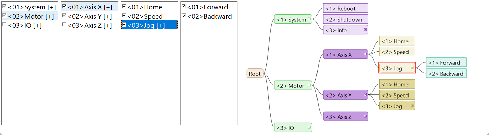
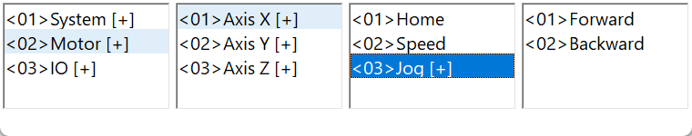
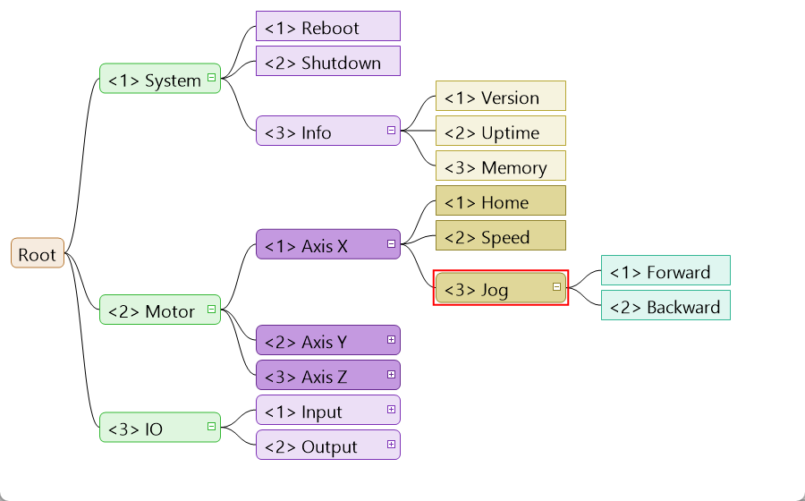

# CascadeControl

用 Miller Columns（多欄串接）與樹狀圖呈現多層選單的 WinForms 控制項庫。
選單用一份簡單的 CSV 描述，載入後就能用鍵盤或滑鼠一層一層選到終點去執行，也可以勾選其中一部分再輸出成 CSV。



**適合用在**

- Debug 選單、設定項目、測試步驟這類「路徑深淺不一，最後選到一個終點去執行」的多層選單。
- 選單內容常常改，想用一份 CSV 維護，不想改程式。
- 要從一棵大樹裡勾出一部分（例如這次要跑的測試項目），存成檔案、下次再套回來。

---

## 兩種檢視

### CascadeColumnsView：多欄選單

選了某一項，如果它還有下一層，右邊就長出一欄；用 ↑↓ 改選、→ 進入下一層、← 退回、Enter 執行。



```csharp
using CascadeControl.State;
using CascadeControl.Trees;
using CascadeControl.Trees.Csv;
using CascadeControl.Views.Columns;

MenuTree menu = MenuTreeCsvFile.Load("menu.csv", out IList<string> warnings);

var cascadeView1 = new CascadeColumnsView { Dock = DockStyle.Fill };
Controls.Add(cascadeView1);
cascadeView1.SetTree(menu);

// 在選取的節點上雙擊或按 Enter 時觸發
cascadeView1.NodeActivated += (s, e) =>
{
    if (e.IsLeaf) MessageBox.Show($"執行：{e.PathText}");   // 例如「Motor => Axis X => Jog => Forward」
};
```

### CascadeDiagramView：樹狀圖

把同一棵樹畫成圖，標出目前的選取；可以單獨使用，也可以和 `CascadeColumnsView` 共享 `State`，兩邊的選取與勾選會自動同步。



```csharp
using CascadeControl.Views.Diagram;

var diagramView1 = new CascadeDiagramView { Dock = DockStyle.Fill };
Controls.Add(diagramView1);

// 單獨使用
diagramView1.SetTree(menu);

// 或與 CascadeColumnsView 共享狀態（最上面那張圖就是這樣接的）
diagramView1.State = cascadeView1.State;
cascadeView1.CheckBoxes = true;   // 開啟勾選
```

---

## 樹結構描述語法

每行格式：

```
第1層,第2層,第3層,...
```

符號定義：

- `,`：表示下一層。
- `|`：表示同層多選，依笛卡兒積展開。

解析規則：

- 所有行共用一個隱含根節點 root，每行第一個名稱為其直接子節點。
- 節點以 (父節點, 名稱) 唯一識別；同一父節點下的同名節點合併，不同父節點下的同名節點獨立。
- 依序展開各行路徑，節點不存在時建立，已存在時沿用。

上面截圖用的就是這份資料（第一列是表頭）：

```csv
Level1,Level2,Level3,Level4
System,Reboot|Shutdown,,
System,Info,Version|Uptime|Memory,
Motor,Axis X|Axis Y|Axis Z,Home|Speed,
Motor,Axis X|Axis Y|Axis Z,Jog,Forward|Backward
IO,Input,DI0|DI1|DI2,
IO,Output,DO0|DO1,
```

`Motor,Axis X|Axis Y|Axis Z,Jog,Forward|Backward` 一行就展開成 3 × 2 = 6 條路徑。
從檔案讀用 `MenuTreeCsvFile.Load`，從字串讀用 `MenuTreeCsvText.Parse`；兩者都不丟例外，有問題的列寫進 `warnings`。
警告的種類、展開上限與寫出格式見 [CSV 格式](docs/guide.md#csv-格式)。

---

## 功能一覽

| 功能 | 說明 |
|---|---|
| [欄寬與顯示欄數](docs/guide.md#欄寬與顯示欄數) | `Fixed`、`Fill`、`Sliding` 三種排版 |
| [退回與記憶軌跡](docs/guide.md#退回與記憶軌跡) | ← 退回後按 → 沿原路走回去 |
| [編輯](docs/guide.md#編輯) | 右鍵功能表與快捷鍵插入、改名、剪下、貼上、刪除，支援[復原與重做](docs/guide.md#復原與重做) |
| [勾選](docs/guide.md#勾選) | 勾選一部分節點，輸出成只含勾選節點的樹或 CSV，也能套回 |
| [自訂外觀](docs/guide.md#自訂外觀) | 顏色、欄寬，或用 `DrawNode` 完全自繪 |
| [有向圖](docs/guide.md#api-速查) | `MenuGraph` 以 `From,To` 描述共用節點的選單，再展開成樹 |

完整說明與 API 速查見 **[docs/guide.md](docs/guide.md)**。

---

## 需求與安裝

- .NET Framework 4.8、Windows Forms，不需要第三方套件。
- 參考建置輸出的 `CascadeControl.dll`，並把 `CascadeControl.xml` 放在同一個資料夾（IntelliSense 的中文說明來自這個檔案）。
- 也可以在工具箱按右鍵「選擇項目」加入 `CascadeColumnsView`、`CascadeDiagramView`，直接拖到表單上。

## 範例程式

| 專案 | 內容 |
|---|---|
| `CascadeControlSelector` | 多欄選單＋樹狀圖；把 CSV 拖進視窗即可載入 |
| `CascadeControlViewer` | 多欄選單＋樹狀圖，含勾選；同樣支援拖放 CSV |

README 的截圖由 `tools/capture-screenshots.ps1` 從真正的控制項產生，UI 改了重跑即可更新：

```powershell
powershell -NoProfile -File tools\capture-screenshots.ps1
```

## 授權

[MIT](LICENSE)
