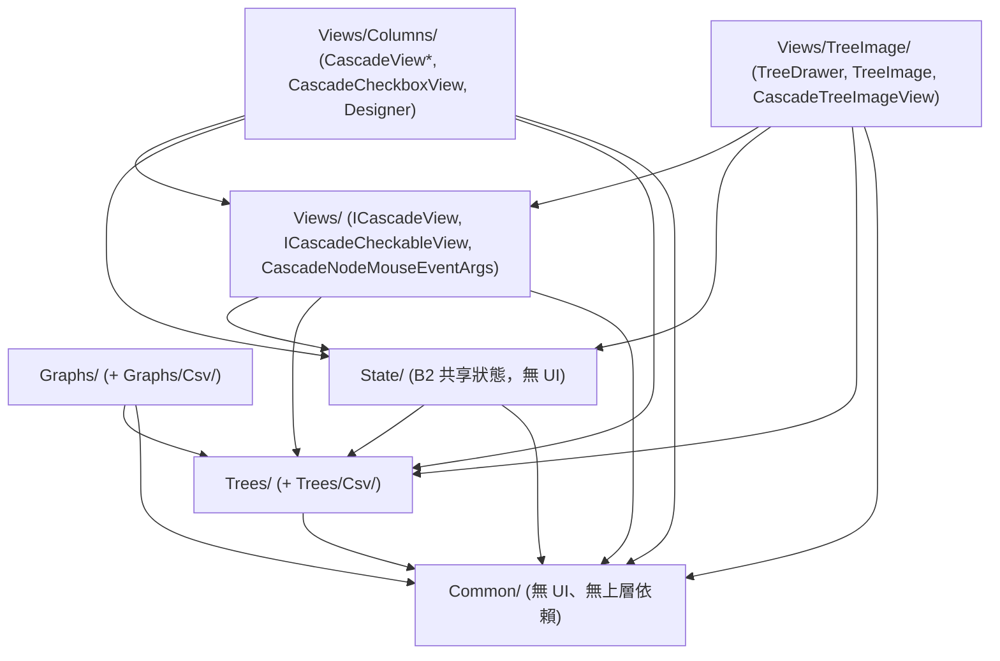

# CascadeControl 設計紀錄

這份文件記錄 `CascadeControl` 兩次已執行完的重構，依時間先後排列。兩份計畫原本各自一檔（`docs/refactor-plan.md` 與 `docs/view-unification-plan.md`），合併後保留當時的決策、理由、commit、對照表、依賴圖與驗證指令。

1. 資料夾結構重構（2026-11-20）把檔案依領域分到 `Common/`、`Trees/`、`Graphs/`、`State/`、`Views/` 底下，再把命名空間對齊資料夾。
2. CascadeDiagramView 與 CascadeColumnsView 統一（2026-11-22）把改樹、復原歷史與編輯事件從 View 移到 `CascadeState`，讓兩個 View 支援相同的編輯指令。

文中的型別名稱、路徑與測試數都是當時的狀態。兩次重構之間，commit `c8e63f2` 把 `CascadeView` 改名為 `CascadeColumnsView`、`CascadeTreeImageView` 改名為 `CascadeDiagramView`，commit `99feb48` 把 `CascadeCheckboxView` 併入 `CascadeColumnsView`。所以第一部分的 `Views/TreeImage/` 在第二部分是 `Views/Diagram/`。第二部分完成後，Diagram 又加了多選與拖曳移動（`CascadeDiagramView.MultiSelect.cs`、`CascadeDiagramView.DragMove.cs`），不在這兩份計畫的範圍內。

## 資料夾結構重構（2026-11-20）

這一部分記錄 `CascadeControl` 與 `CascadeControlTests` 的領域導向資料夾重組規劃與執行結果。先前的 Plan A、Plan B2 與 Post-B2 事件統一重構已完成於 commit `9a39f85`，成為本計畫的基線。第一輪（Step 1 至 Step 5，只搬資料夾、不改 namespace）與第二輪（Step 1 至 Step 4，對齊 C# IDE0130 namespace 規範）的程式碼異動、自動化驗證與 Visual Studio IDE 設計工具確認皆已完成。

### 目標與限制

- 分類準則依「領域與職責」劃分，不依「技術型別」建立資料夾（不建 `Interfaces/`、`EventArgs/`、`Enums/`、`Designers/`），以既有 `Trees/` 與 `Graphs/`（含各自的 `Csv/` 子資料夾）為範例。
- 依賴方向必須嚴格單向，特別是 `Views` 可依賴 `State`，`State` 不可依賴 `Views`，`Common` 不可依賴任何上層領域。
- `CascadeView.cs` 與五個 partial 檔必須留在同一個資料夾，並在 `CascadeControl/CascadeControl.csproj` 同步維護 `<Compile Include>` 與 `<DependentUpon>CascadeView.cs</DependentUpon>`。
- 所有搬遷一律使用 `git mv` 保留檔案歷史。
- 第一輪採「只搬資料夾、不改 namespace」，詳見下方的 Blast-Radius 評估。
- 每個步驟都必須獨立通過 Debug 與 Release 建置（0 錯誤、0 新增警告）、440 個單元測試全綠、組件反射與表單實例化檢查，以及在 Visual Studio 中確認 `TreeSelector` 與 `TreeViewer` 兩個 WinForms 設計工具都能正常開啟。

---

### 現況盤點（`/pstack:how` 結果）

`CascadeControl/` 目前共 40 個 `.cs` 檔（含 `Properties/AssemblyInfo.cs`），分成 `Common/`、`Trees/`、`Graphs/`、`Views/` 四個資料夾。在型別層級的依賴已經是單向無環的，但資料夾層級有三個結構問題。

#### 1. `Common/` 混放三個無關職責並造成資料夾與命名空間循環

| 檔案 | 公開／內部型別 | 領域與職責 | 內部依賴（`file:line`） | UI／繪圖／設計依賴 |
|---|---|---|---|---|
| `Common/ICascadeNode.cs` | `ICascadeNode`、`CascadeNode` | 核心節點抽象與預設實作 | 無（僅 XML 註解提及 `CascadeView`） | 無 |
| `Common/MultiNameCellSyntax.cs` | `MultiNameCellSyntax` | `\|` 多名稱儲存格語法與笛卡兒展開 | 無（僅 XML 註解提及 `MenuTree`、`MenuGraph`） | 無 |
| `Common/CsvFile.cs` | `internal CsvFile` | RFC 4180 CSV 解析與格式化 | 無 | 無 |
| `Common/TreeImage.cs` | `TreeImage`、`TreeImageNode` | 樹狀圖渲染輸出與節點／展開鈕命中測試 | `CascadeControl.Trees.MenuNode`（`L1,38,53,80,91`） | `System.Drawing`（`L4`） |
| `Common/TreeDrawer.cs` | `TreeDrawScope`、`UncheckedNodeDisplay`、`TreeDrawer` | `MenuTree` 的 GDI+ 排版與繪圖引擎 | `CascadeControl.Trees`（`L1,160-165,192-198`）、`TreeImage`（`L214`） | `System.Drawing`（`L4-6`）、`System.Windows.Forms.PictureBox`（`L8,159`） |

`TreeDrawer.cs` 與 `TreeImage.cs` 在整個程式庫中只有 `Views/CascadeTreeImageView.cs`（`L62-64,351,401`）使用，卻放在 `Common/` 裡，造成 `Common ↔ Trees` 的雙向循環依賴，並把 `System.Drawing` 與 `System.Windows.Forms` 帶入原本純淨的基礎層。

#### 2. `Views/` 中 B2 抽出的狀態與導覽型別已完全脫離 UI，但 `CascadeNodeEventArgs.cs` 混放了三種層級的型別

| 檔案 | 公開／內部型別 | 領域與職責 | 內部依賴（`file:line`） | UI／繪圖／設計依賴 |
|---|---|---|---|---|
| `Views/CascadeNavigator.cs` | `internal CascadeNavigator` | 選取路徑與逐節點記憶軌跡狀態機 | `Common.ICascadeNode`（`L1,23-196`） | 無 |
| `Views/CascadeState.cs` | `CascadeState`、`internal CascadeStateInvalidation` | B2 共享樹資料、選取與導覽狀態 | `Common.ICascadeNode`、`Trees.MenuTree`/`MenuNode`（`L1-2`）、`CascadeNavigator`、`CascadeNodeEventArgs`（`L38,92`） | 無 |
| `Views/CascadeCheckableState.cs` | `CascadeCheckableState` | B2 共享勾選狀態生命週期 | `Common.ICascadeNode`、`Trees.MenuTree`/`MenuCheckSet`/`MenuCheckChangedEventArgs`（`L1-2`）、`CascadeState`（`L14`） | 無 |
| `Views/ICascadeView.cs` | `ICascadeView` | 三個檢視控制項共用的導覽契約 | `Common.ICascadeNode`、`Trees.MenuTree`/`MenuNode`（`L1-2`）、`CascadeNodeEventArgs`（`L87,92`） | 無 |
| `Views/ICascadeCheckableView.cs` | `ICascadeCheckableView` | 具備勾選能力的檢視契約 | `Trees.MenuCheckSet`/`MenuCheckChangedEventArgs`（`L1`）、`ICascadeView`（`L9`） | 無 |
| `Views/CascadeNodeEventArgs.cs` | `CascadeNodeEventArgs`、`CascadeNodeMouseEventArgs`、`CascadeDrawNodeEventArgs` | **混層檔案**：無 UI 路徑事件、WinForms 滑鼠事件、GDI+ 自繪事件同放一檔 | `Common.ICascadeNode`（`L1`）、`CascadeNavigator.DEFAULT_PATH_SEPARATOR`（`L34`） | `CascadeNodeEventArgs` 無 UI 依賴；`CascadeNodeMouseEventArgs` 依賴 `System.Windows.Forms.MouseButtons`（`L99,112`）與 `System.Drawing`（`L4,100`）；`CascadeDrawNodeEventArgs` 依賴 `System.Drawing`（`L4,140`） |
| `Views/CascadeTreeEditedEventArgs.cs` | `CascadeEditAction`、`CascadeTreeEditedEventArgs` | Miller Columns 樹編輯事件契約 | `Trees.MenuNode`（`L1,48,62`） | 無 |
| `Views/CascadeColumnLayoutMode.cs` | `CascadeColumnLayoutMode` | Miller Columns 欄寬排版模式（`Fixed`/`Fill`/`Sliding`） | 無 | 無 |
| `Views/CascadeView.cs` + 5 partials（`Columns`/`Editing`/`Input`/`MultiSelect`/`Rendering`） | `CascadeView`、`internal SelectionGesture`、`internal NativeMethods` | Miller Columns 控制項本體（排版、輸入、多選、自繪、就地編輯與剪貼簿） | `Common`、`Trees`、`Trees.Csv.MenuTreeCsvText`（`Editing.cs:3,683`）、`CascadeState`、`CascadeNavigator`、`ICascadeView`、`CascadeViewDesigner`（`CascadeView.cs:31`） | `System.Windows.Forms`、`System.Drawing`、`user32.dll` P/Invoke（`Rendering.cs:203-215`） |
| `Views/CascadeCheckboxView.cs` | `CascadeCheckboxView` | 含勾選框的 Miller Columns 控制項 | `Common`、`Trees`、`CascadeView`、`CascadeCheckableState`、`ICascadeCheckableView` | `System.Windows.Forms`、`System.Windows.Forms.VisualStyles`（`L7`） |
| `Views/CascadeViewDesigner.cs` | `internal CascadeViewDesigner` | `CascadeView`／`CascadeCheckboxView` 設計階段控制項設計工具 | 無（由 `CascadeView.cs:31` 透過 `[Designer(typeof(CascadeViewDesigner))]` 引用） | `System.Windows.Forms.Design.ControlDesigner`（`System.Design`、`L4,17`） |
| `Views/CascadeTreeImageView.cs` | `TreeImageSizeMode`、`CascadeTreeImageView` | 樹狀圖檢視控制項（獨立運作或共享 `CascadeState`） | `Common`（`ICascadeNode`、`TreeDrawer`、`TreeImage`、`TreeDrawScope`、`UncheckedNodeDisplay`）、`Trees`、`CascadeState`、`CascadeCheckableState`、`ICascadeView`、`CascadeNodeEventArgs`/`MouseEventArgs` | `System.Windows.Forms`、`System.Drawing` |

檢查確認：`CascadeNavigator`、`CascadeState`、`CascadeCheckableState` 三個檔案對 `CascadeView`、`CascadeCheckboxView`、`CascadeTreeImageView`、`ICascadeView`、`System.Windows.Forms`、`System.Drawing` 全部是零依賴。唯一阻礙它們獨立移入 `State/` 的耦合點，是 `CascadeState.cs:92` 依賴 `CascadeNodeEventArgs`，而 `CascadeNodeEventArgs.cs` 同檔夾帶了 `CascadeNodeMouseEventArgs` 與 `CascadeDrawNodeEventArgs`。

#### 3. `Trees/`、`Graphs/` 與 `CascadeControlTests/`

- `Trees/`（7 檔 + `Trees/Csv/` 2 檔）只依賴 `Common/`，無 UI 依賴，符合領域劃分範例。
- `Graphs/`（6 檔 + `Graphs/Csv/` 2 檔）只依賴 `Common/` 與 `Trees/`（`MenuGraph.cs:2` 的 `FromTree`/`ToTree`），無 UI 依賴，符合領域劃分範例。
- `CascadeControlTests/` 目前有兩處錯置：`Common/TreeDrawerTests.cs` 同時測試 `TreeDrawer` 與 `CascadeTreeImageView`（需 `using CascadeControl.Views` 與 WinForms）；`Views/CascadeStateTests.cs` 與 `Views/CascadeNavigatorTests.cs` 是純非 UI 狀態測試，卻與 WinForms `ViewHost` 測試混在 `Views/`。

---

### 目標資料夾樹與搬遷對照

#### `CascadeControl/` 目標結構（40 檔拆成 42 檔）

```text
CascadeControl/
├── Common/                              # 共用基礎層（零上層領域與 UI 依賴）
│   ├── ICascadeNode.cs
│   ├── MultiNameCellSyntax.cs
│   └── CsvFile.cs
├── Trees/                               # 樹狀選單資料領域（維持不變）
│   ├── MenuNode.cs
│   ├── MenuTree.cs
│   ├── MenuRowStyle.cs
│   ├── MenuTreeRowWriter.cs
│   ├── MenuCheckSet.cs
│   ├── MenuCheckChangedEventArgs.cs
│   ├── MenuHistory.cs
│   └── Csv/
│       ├── MenuTreeCsvText.cs
│       └── MenuTreeCsvFile.cs
├── Graphs/                              # 有向圖資料領域（維持不變）
│   ├── MenuVertex.cs
│   ├── MenuEdge.cs
│   ├── MenuGraph.cs
│   ├── MenuGraphNode.cs
│   ├── MenuGraphRowStyle.cs
│   ├── MenuGraphRowWriter.cs
│   └── Csv/
│       ├── MenuGraphCsvText.cs
│       └── MenuGraphCsvFile.cs
├── State/                               # B2 共享導覽與勾選狀態領域（零 UI／繪圖依賴）
│   ├── CascadeNavigator.cs
│   ├── CascadeState.cs
│   ├── CascadeCheckableState.cs
│   └── CascadeNodeEventArgs.cs          # 拆分後僅保留無 UI 的 CascadeNodeEventArgs
├── Views/                               # 檢視層根目錄（多個控制項共用的契約與事件）
│   ├── ICascadeView.cs
│   ├── ICascadeCheckableView.cs
│   ├── CascadeNodeMouseEventArgs.cs     # 由 CascadeNodeEventArgs.cs 拆出，供 Columns 與 TreeImage 共用
│   ├── Columns/                         # Miller Columns 控制項領域（全部 partial 同資料夾）
│   │   ├── CascadeView.cs
│   │   ├── CascadeView.Columns.cs       # DependentUpon: CascadeView.cs
│   │   ├── CascadeView.Editing.cs       # DependentUpon: CascadeView.cs
│   │   ├── CascadeView.Input.cs         # DependentUpon: CascadeView.cs
│   │   ├── CascadeView.MultiSelect.cs   # DependentUpon: CascadeView.cs
│   │   ├── CascadeView.Rendering.cs     # DependentUpon: CascadeView.cs
│   │   ├── CascadeCheckboxView.cs
│   │   ├── CascadeColumnLayoutMode.cs
│   │   ├── CascadeDrawNodeEventArgs.cs  # 由 CascadeNodeEventArgs.cs 拆出，僅供 Columns 使用
│   │   ├── CascadeTreeEditedEventArgs.cs
│   │   └── CascadeViewDesigner.cs
│   └── TreeImage/                       # 樹狀圖渲染與檢視領域（消除 Common ↔ Trees 循環）
│       ├── TreeDrawer.cs
│       ├── TreeImage.cs
│       └── CascadeTreeImageView.cs
└── Properties/
    └── AssemblyInfo.cs
```

#### 檔案搬遷對照表（`CascadeControl/`）

| 來源路徑 | 目標路徑 | 動作 | 原因 |
|---|---|---|---|
| `Common/ICascadeNode.cs` | `Common/ICascadeNode.cs` | 不動 | 全專案共用節點最小契約，零外部依賴 |
| `Common/MultiNameCellSyntax.cs` | `Common/MultiNameCellSyntax.cs` | 不動 | `Trees`、`Graphs` 與 `CascadeView.Editing` 共用的 `\|` 語法，零外部依賴 |
| `Common/CsvFile.cs` | `Common/CsvFile.cs` | 不動 | `Trees/Csv` 與 `Graphs/Csv` 共用的 RFC 4180 CSV 讀寫，零外部依賴 |
| `Common/TreeDrawer.cs` | `Views/TreeImage/TreeDrawer.cs` | `git mv` | 依賴 `Trees`、`System.Drawing` 與 `PictureBox`，且僅供 `CascadeTreeImageView` 使用；移出 `Common/` 才能消除 `Common ↔ Trees` 循環 |
| `Common/TreeImage.cs` | `Views/TreeImage/TreeImage.cs` | `git mv` | 依賴 `Trees` 與 `System.Drawing`，是 `TreeDrawer` 輸出與 `CascadeTreeImageView` 命中測試模型 |
| `Trees/**`（9 檔） | `Trees/**`（9 檔） | 不動 | 既有的領域分組範例，邊界與單向依賴皆正確 |
| `Graphs/**`（8 檔） | `Graphs/**`（8 檔） | 不動 | 既有的領域分組範例，只單向依賴 `Trees` 與 `Common` |
| `Views/CascadeNavigator.cs` | `State/CascadeNavigator.cs` | `git mv` | 純非 UI 導覽狀態機，只依賴 `Common.ICascadeNode` |
| `Views/CascadeState.cs` | `State/CascadeState.cs` | `git mv` | B2 抽出的共享資料與導覽狀態，零 WinForms 依賴 |
| `Views/CascadeCheckableState.cs` | `State/CascadeCheckableState.cs` | `git mv` | B2 抽出的共享勾選狀態，零 WinForms 依賴 |
| `Views/CascadeNodeEventArgs.cs` | `State/CascadeNodeEventArgs.cs` | 拆檔 + `git mv` | 僅保留無 UI 的 `CascadeNodeEventArgs`，讓 `State/` 不必反過來依賴 `Views/` 或 `System.Drawing` |
| （從 `Views/CascadeNodeEventArgs.cs` 拆出） | `Views/CascadeNodeMouseEventArgs.cs` | 新增檔案 | 依賴 `System.Windows.Forms.MouseButtons` 與 `System.Drawing`，同時由 `CascadeView` 與 `CascadeTreeImageView` 觸發，屬於 `Views/` 根層共用型別 |
| （從 `Views/CascadeNodeEventArgs.cs` 拆出） | `Views/Columns/CascadeDrawNodeEventArgs.cs` | 新增檔案 | 依賴 `System.Drawing`，僅用於 `CascadeView.DrawNode` 與 `CascadeCheckboxView`，屬於 Miller Columns 領域 |
| `Views/ICascadeView.cs` | `Views/ICascadeView.cs` | 不動 | 由 `Views/Columns/` 與 `Views/TreeImage/` 共同實作的檢視契約，放在 `Views/` 根層不建 `Interfaces/` 資料夾 |
| `Views/ICascadeCheckableView.cs` | `Views/ICascadeCheckableView.cs` | 不動 | 由 `CascadeCheckboxView` 實作的勾選檢視契約，與 `ICascadeView` 同放 `Views/` 根層 |
| `Views/CascadeView.cs` | `Views/Columns/CascadeView.cs` | `git mv` | Miller Columns 控制項主檔 |
| `Views/CascadeView.Columns.cs` | `Views/Columns/CascadeView.Columns.cs` | `git mv` + `DependentUpon` | 與 `CascadeView.cs` 同資料夾，補上 `<DependentUpon>CascadeView.cs</DependentUpon>` |
| `Views/CascadeView.Editing.cs` | `Views/Columns/CascadeView.Editing.cs` | `git mv` + `DependentUpon` | 與 `CascadeView.cs` 同資料夾，補上 `<DependentUpon>CascadeView.cs</DependentUpon>` |
| `Views/CascadeView.Input.cs` | `Views/Columns/CascadeView.Input.cs` | `git mv` + `DependentUpon` | 與 `CascadeView.cs` 同資料夾，補上 `<DependentUpon>CascadeView.cs</DependentUpon>` |
| `Views/CascadeView.MultiSelect.cs` | `Views/Columns/CascadeView.MultiSelect.cs` | `git mv` + `DependentUpon` | 與 `CascadeView.cs` 同資料夾，補上 `<DependentUpon>CascadeView.cs</DependentUpon>` |
| `Views/CascadeView.Rendering.cs` | `Views/Columns/CascadeView.Rendering.cs` | `git mv` + `DependentUpon` | 與 `CascadeView.cs` 同資料夾，補上 `<DependentUpon>CascadeView.cs</DependentUpon>` |
| `Views/CascadeCheckboxView.cs` | `Views/Columns/CascadeCheckboxView.cs` | `git mv` | 繼承 `CascadeView`，同屬 Miller Columns 控制項家族 |
| `Views/CascadeColumnLayoutMode.cs` | `Views/Columns/CascadeColumnLayoutMode.cs` | `git mv` | 僅供 `CascadeView` 欄位排版使用 |
| `Views/CascadeTreeEditedEventArgs.cs` | `Views/Columns/CascadeTreeEditedEventArgs.cs` | `git mv` | 僅供 `CascadeView.TreeEdited` 與 `CascadeCheckboxView` 使用 |
| `Views/CascadeViewDesigner.cs` | `Views/Columns/CascadeViewDesigner.cs` | `git mv` | 只為 `CascadeView`／`CascadeCheckboxView` 服務的設計工具，放同領域避免建立單檔技術型別資料夾 `Design/` |
| `Views/CascadeTreeImageView.cs` | `Views/TreeImage/CascadeTreeImageView.cs` | `git mv` | 樹狀圖檢視控制項，與 `TreeDrawer`、`TreeImage` 組成獨立子領域，和 `Views/Columns/` 互不相依 |
| `Properties/AssemblyInfo.cs` | `Properties/AssemblyInfo.cs` | 不動 | 組件中繼資料與 `InternalsVisibleTo("CascadeControlTests")` |

#### 對應測試搬遷（`CascadeControlTests/`）

| 來源路徑 | 目標路徑 | 動作 | 原因 |
|---|---|---|---|
| `Common/CsvFileTests.cs` | `Common/CsvFileTests.cs` | 不動 | 對應 `Common/CsvFile.cs` |
| `Common/MultiNameCellSyntaxTests.cs` | `Common/MultiNameCellSyntaxTests.cs` | 不動 | 對應 `Common/MultiNameCellSyntax.cs` |
| `Common/TreeDrawerTests.cs` | `Views/TreeImage/TreeDrawerTests.cs` | `git mv` | 對應 `Views/TreeImage/`（測試 `TreeDrawer`、`TreeImage` 與 `CascadeTreeImageView`） |
| `Trees/**`（8 檔）、`Graphs/**`（9 檔） | 不動 | 不動 | 與產品專案維持 1-to-1 對應 |
| `Views/CascadeNavigatorTests.cs` | `State/CascadeNavigatorTests.cs` | `git mv` | 純非 UI 導覽測試，對應 `State/CascadeNavigator.cs` |
| `Views/CascadeStateTests.cs` | `State/CascadeStateTests.cs` | `git mv` | 純非 UI 狀態測試，對應 `State/CascadeState.cs` 與 `CascadeCheckableState.cs` |
| `Views/CascadeNodeTests.cs` | `Views/CascadeNodeTests.cs` | 不動 | 同時測試 `CascadeNode`、`CascadeNodeEventArgs` 與依賴 WinForms 的 `CascadeNodeMouseEventArgs`，留在 `Views/` 根層以保持 `Tests/State/` 零 UI 依賴 |
| `Views/CascadeCheckboxViewTests.cs` | `Views/Columns/CascadeCheckboxViewTests.cs` | `git mv` | 對應 `Views/Columns/CascadeCheckboxView.cs` |
| `Views/CascadeViewHookTests.cs` | `Views/Columns/CascadeViewHookTests.cs` | `git mv` | 對應 `Views/Columns/CascadeView*.cs` |
| `Views/CascadeViewLayoutTests.cs` | `Views/Columns/CascadeViewLayoutTests.cs` | `git mv` | 對應 `Views/Columns/CascadeView.Columns.cs` |
| `Views/CascadeViewMultiSelectTests.cs` | `Views/Columns/CascadeViewMultiSelectTests.cs` | `git mv` | 對應 `Views/Columns/CascadeView.MultiSelect.cs` |

#### 單向依賴圖（嚴格無環）



- `Common/` 沒有任何往外依賴。
- `State/` 只依賴 `Common/` 與 `Trees/`，不依賴 `Views/`、`System.Drawing`、`System.Windows.Forms`。
- `Views/Columns/` 與 `Views/TreeImage/` 彼此零依賴，皆只向下依賴 `Views/` 根層、`State/`、`Trees/`、`Common/`。

---

### Namespace 變更的 Blast-Radius 評估

#### 變更內容

比較兩種方案：
1. **方案 A（建議，第一輪執行）**：只重組資料夾並拆開 `CascadeNodeEventArgs.cs`，全部既有公開與內部型別維持原 `namespace`（`CascadeControl.Common`、`CascadeControl.Trees`、`CascadeControl.Graphs`、`CascadeControl.Views`）。
2. **方案 B（延後為選配第二輪）**：同步更改 `namespace`（例如 `CascadeControl.State`、`CascadeControl.Views.Columns`、`CascadeControl.Views.TreeImage`）。

#### 方案 A 安全的關鍵事實與實測證明

**關鍵事實**：在 .NET Framework 4.8 MSBuild 專案中，只更改 `.cs` 檔案路徑而保留 `namespace` 宣告，編譯出的 CLR 型別全名、`[Designer(typeof(CascadeViewDesigner))]` 的組件限定設計工具字串，以及 `CascadeControl.xml` 的 XML 文件識別碼（`T:*`）完全不變。

**驗證進度**：已推進到 **Blast-Radius 第 4 階（實際執行程式驗證）**。於 `2026-11-20` 對已建置的 `CascadeControl.dll`、`CascadeControl.xml`、`CascadeControlSelector.exe`、`CascadeControlViewer.exe` 執行 PowerShell `.NET` 反射與 `TypeDescriptor` 探測，實測結果如下：

- `CascadeControl.Views.CascadeView` 的 `DesignerAttribute.DesignerTypeName` 為 `CascadeControl.Views.CascadeViewDesigner, CascadeControl, Version=1.3.0.0, Culture=neutral, PublicKeyToken=null`，解析為 `CascadeControl.Views.CascadeViewDesigner`，實例化成功。
- `CascadeControl.Views.CascadeCheckboxView` 繼承同一個 `CascadeControl.Views.CascadeViewDesigner`，實例化成功。
- `CascadeControl.Views.CascadeTreeImageView` 的設計工具解析為 `System.Windows.Forms.Design.ScrollableControlDesigner`，實例化成功。
- `CascadeControl.xml` 共 62 筆 `T:` 型別識別碼，全部只含命名空間與型別名，不含任何檔案路徑。
- `CascadeControlSelector.TreeSelector`（`Controls=2`）與 `CascadeControlViewer.TreeViewer`（`Controls=1`）實例化成功，其 `TreeSelector.resx` 與 `TreeViewer.resx` 不含任何 `CascadeControl.*` 序列化型別資料。

#### 若改 Namespace（方案 B）的具體影響清單與風險

| 受影響目標 | 實際位置（`file:line`） | 若改 namespace 會如何壞掉 | 機率與成本 |
|---|---|---|---|
| `CascadeControlSelector/TreeSelector.Designer.cs` | `L33,34,70,82,83,84,117,118`（8 行全限定名稱：`CascadeControl.Views.CascadeView`、`CascadeTreeImageView`、`CascadeNodeEventArgs`、`CascadeNodeMouseEventArgs`） | WinForms 設計工具序列化寫死完整型別名；任何一個控制項或事件參數改 namespace，必須手動編輯 Designer 檔，漏改或與控制項組件不對齊時設計工具會直接顯示白屏錯誤無法開啟 | 高機率、高成本（直接破設計工具） |
| `CascadeControlViewer/TreeViewer.Designer.cs` | `L32,34,53,54,85,86,87,108,110`（9 行 `CascadeControl.Views.*`，另 `L52` 為不變的 `CascadeControl.Trees.MenuCheckChangedEventArgs`） | 同上；`CascadeCheckboxView`、`CascadeTreeImageView` 與事件參數全限定名稱都寫死在 `InitializeComponent()` 與欄位宣告 | 高機率、高成本（直接破設計工具） |
| `CascadeControlSelector/TreeSelector.cs` 與 `CascadeControlViewer/TreeViewer.cs` | `TreeSelector.cs:1-4,82`、`TreeViewer.cs:1-4,84-85` | `TreeDrawScope`、`UncheckedNodeDisplay`（原 `Common`）與 `CascadeColumnLayoutMode`、`CascadeNodeEventArgs` 等（原 `Views`）的 `using` 會編譯失敗 | 必然發生、低成本（補 `using` 即可） |
| `CascadeControlTests/` | 10 個測試檔引用 `CascadeControl.Views`（`TreeDrawerTests.cs:3` 與 `Views/*.cs`），15 個測試檔引用 `CascadeControl.Common` | 測試檔需同步補 `using`；若測試專案本身改 namespace，VSTest 測試全名也會跟著變動 | 必然發生、中成本 |
| `CascadeControl/` XML `<see cref>` 文件註解 | `CascadeControl.csproj:23-24,32-33`（`WarningLevel=4` + `DocumentationFile`）；跨檔引用見 `CascadeNodeEventArgs.cs:10`、`CascadeNavigator.cs:9`、`CascadeCheckableState.cs:12`、`MenuCheckSet.cs:16,51` | 跨命名空間的 `<see cref>` 會觸發 CS1574 編譯警告，導致 IntelliSense XML 連結失效 | 高機率、中成本 |
| `README.md` | `L21,67-69,275,481,520,528,577,589,597,618,627,646,655,662,687`（15 處明載命名空間與範例 `using`） | 文件與實際命名空間脫節；外部使用者依 `README.md:31-43` 從工具箱加入 `CascadeControl.dll` 時，控制項型別全名變更會造成既有表單與工具箱失效 | 必然發生、中成本 |

#### 已確認無風險項目（Cleared）

- `TreeSelector.resx` 與 `TreeViewer.resx`：兩檔皆只有標準 `ResX` schema 與表頭（各 120 行），沒有序列化任何 `CascadeControl` 型別。
- `CascadeView.cs:31`：`[Designer(typeof(CascadeViewDesigner))]` 是編譯期 `typeof(...)` 而非硬編碼字串，搬移檔案位置不會讓設計工具連結失效。
- `CascadeControl/Properties/AssemblyInfo.cs:6`：`[assembly: InternalsVisibleTo("CascadeControlTests")]` 綁定的是組件名稱，不受資料夾與命名空間搬移影響。
- `CascadeView.Editing.cs:26`：`CLIPBOARD_FORMAT = "CascadeControl.MenuNodes"` 是固定剪貼簿格式字串，不隨檔案路徑改變。

#### 決策建議

- **第一輪（本計畫執行範圍）**：只搬移資料夾並拆分 `CascadeNodeEventArgs.cs`，**不改任何 `namespace`**。這樣能把「整理資料夾結構」與「破壞性命名空間更名」完全隔開，第一輪零 Designer 風險、零 `README.md` 破壞、`TreeSelector` 與 `TreeViewer` 一行都不用改。
- **第二輪（選配，等第一輪穩定後再另案評估）**：若未來想讓編譯器在 `using` 層級強制封鎖循環，只需考慮兩個低摩擦子選項：
  1. 僅把 `TreeDrawer`、`TreeImage`、`TreeDrawScope`、`UncheckedNodeDisplay` 從 `CascadeControl.Common` 改入 `CascadeControl.Views`（不影響任何 `Designer.cs`，只動 `TreeSelector.cs`、`TreeViewer.cs`、`TreeDrawerTests.cs`、`README.md`），就能在命名空間層級徹底消除 `Common ↔ Trees` 循環。
  2. `CascadeView`、`CascadeCheckboxView`、`CascadeTreeImageView` 即使在第二輪也建議保留在 `CascadeControl.Views`，避免破壞兩個 `Designer.cs` 與 WinForms 工具箱。

---

### 執行步驟與驗證清單（第一輪：只搬資料夾、不改 Namespace）

#### 依賴順序圖

`Step 1` → `Step 2` → `Step 3` → `Step 4` → `Step 5`（全程循序在同一個分支上建立 5 個可獨立驗證與回退的小 commit，每步皆通過建置、測試與設計工具檢查後才進下一步）。

#### 共用驗證指令

每一個步驟完成後，在倉庫根目錄 `D:\github\CascadeControl` 依序執行以下三個自動化檢查，再於 Visual Studio 開啟兩個表單設計工具確認：

```powershell
# 1. Debug 與 Release 建置（0 錯誤、0 新增警告）
& "C:\Program Files\Microsoft Visual Studio\18\Community\MSBuild\Current\Bin\MSBuild.exe" CascadeControl.sln /p:Configuration=Debug /nologo /v:minimal
& "C:\Program Files\Microsoft Visual Studio\18\Community\MSBuild\Current\Bin\MSBuild.exe" CascadeControl.sln /p:Configuration=Release /nologo /v:minimal

# 2. 單元測試全部通過（每一步的測試數記在該步的結果裡）
& "C:\Program Files\Microsoft Visual Studio\18\Community\Common7\IDE\CommonExtensions\Microsoft\TestWindow\vstest.console.exe" CascadeControlTests\bin\Debug\CascadeControlTests.dll

# 3. 設計工具屬性與表單實例化驗證（驗證 CascadeViewDesigner 綁定與 InitializeComponent）
powershell -NoProfile -Command '
Add-Type -AssemblyName System.Windows.Forms
Add-Type -AssemblyName System.Design
$asm = [System.Reflection.Assembly]::LoadFrom("D:\github\CascadeControl\CascadeControl\bin\Debug\CascadeControl.dll")
foreach ($n in @("CascadeControl.Views.CascadeView","CascadeControl.Views.CascadeCheckboxView","CascadeControl.Views.CascadeTreeImageView")) {
	$t = $asm.GetType($n)
	$da = [System.ComponentModel.TypeDescriptor]::GetAttributes($t)[[System.ComponentModel.DesignerAttribute]]
	$dt = [Type]::GetType($da.DesignerTypeName)
	if (-not $dt) { throw "Designer resolution failed for $n" }
	$inst = [Activator]::CreateInstance($t); $inst.Dispose()
	Write-Output "$n -> $($dt.FullName) OK"
}
[System.Reflection.Assembly]::LoadFrom("D:\github\CascadeControl\CascadeControlSelector\bin\Debug\CascadeControlSelector.exe") | Out-Null
[System.Reflection.Assembly]::LoadFrom("D:\github\CascadeControl\CascadeControlViewer\bin\Debug\CascadeControlViewer.exe") | Out-Null
$s = New-Object CascadeControlSelector.TreeSelector; if ($s.Controls.Count -lt 2) { throw "TreeSelector missing controls" }; $s.Dispose()
$v = New-Object CascadeControlViewer.TreeViewer; if ($v.Controls.Count -lt 1) { throw "TreeViewer missing controls" }; $v.Dispose()
Write-Output "Forms OK"
'
```

第二部分的每一步也跑第 1、2 項，標示「API 比對」的步驟再比對公開 API，見[共用驗證](#共用驗證)。

---

#### Step 1：拆分 `CascadeNodeEventArgs.cs` 為三個單一職責檔案（commit `7369f91`）

把程式碼拆檔與後續 `git mv` 分開成獨立 commit，確保後續步驟 `git log --follow` 維持 100% 檔案更名偵測率。

- [x] **前置依賴**：工作目錄乾淨（基線 commit `9a39f85`）。
- [x] **異動檔案**：
  - 修改 `CascadeControl/Views/CascadeNodeEventArgs.cs`（僅保留 `CascadeNodeEventArgs` 並移除未使用的 `using System.Drawing;`）。
  - 新增 `CascadeControl/Views/CascadeNodeMouseEventArgs.cs`（放入 `CascadeNodeMouseEventArgs`，維持 `namespace CascadeControl.Views` 與原 XML 註解）。
  - 新增 `CascadeControl/Views/CascadeDrawNodeEventArgs.cs`（放入 `CascadeDrawNodeEventArgs`，維持 `namespace CascadeControl.Views` 與原 XML 註解）。
  - 修改 `CascadeControl/CascadeControl.csproj`（新增兩筆 `<Compile Include>`）。
- [x] **單一變更內容**：將混放三層依賴的 `CascadeNodeEventArgs.cs` 拆開，使 `CascadeNodeEventArgs.cs` 成為 100% 無 UI 依賴的檔案。
- [x] **預期可見結果**：`CascadeNodeEventArgs.cs` 不再出現 `System.Drawing` 或 `System.Windows.Forms`；`CascadeControl.xml` 的 62 個 `T:` 識別碼不變。
- [x] **驗證（Unit / Live / Designer）**：
  - [x] Debug 與 Release MSBuild 通過（0 錯誤、0 新增警告）。
  - [x] `vstest.console.exe` 通過 440 / 440（14.41 秒）。
  - [x] PowerShell 反射探測輸出三個控制項設計工具 `OK` 與 `Forms OK`。
  - [x] Visual Studio 設計工具正常開啟 `CascadeControlSelector/TreeSelector.cs` 與 `CascadeControlViewer/TreeViewer.cs`（操作者於 2026-11-20 確認通過）。

---

#### Step 2：建立 `State/` 領域（搬移 B2 無 UI 狀態與導覽檔案，commit `cae95bb`）

- [x] **前置依賴**：Step 1 通過並 commit（`7369f91`）。
- [x] **異動檔案**：
  - `git mv CascadeControl/Views/CascadeNavigator.cs CascadeControl/State/CascadeNavigator.cs`
  - `git mv CascadeControl/Views/CascadeState.cs CascadeControl/State/CascadeState.cs`
  - `git mv CascadeControl/Views/CascadeCheckableState.cs CascadeControl/State/CascadeCheckableState.cs`
  - `git mv CascadeControl/Views/CascadeNodeEventArgs.cs CascadeControl/State/CascadeNodeEventArgs.cs`
  - `git mv CascadeControlTests/Views/CascadeNavigatorTests.cs CascadeControlTests/State/CascadeNavigatorTests.cs`
  - `git mv CascadeControlTests/Views/CascadeStateTests.cs CascadeControlTests/State/CascadeStateTests.cs`
  - 修改 `CascadeControl/CascadeControl.csproj` 與 `CascadeControlTests/CascadeControlTests.csproj` 的 `<Compile Include>`。
- [x] **單一變更內容**：把 B2 抽出的共享狀態與導覽狀態機集中到 `State/`，測試同步對應。
- [x] **預期可見結果**：`CascadeControl/State/` 共 4 檔，非註解程式碼對 `System.Windows.Forms`、`System.Drawing` 與控制項引用為 0 筆。
- [x] **驗證（Unit / Live / Designer）**：
  - [x] 靜態依賴檢查確認 `CascadeControl/State/` 無 `System.Windows.Forms`、`System.Drawing` 或控制項型別程式碼引用。
  - [x] Debug 與 Release MSBuild 通過（0 錯誤、0 新增警告）。
  - [x] `vstest.console.exe` 通過 440 / 440（14.38 秒）。
  - [x] PowerShell 反射探測輸出 `OK` 與 `Forms OK`。
  - [x] Visual Studio 設計工具正常開啟 `TreeSelector.cs` 與 `TreeViewer.cs`（操作者於 2026-11-20 確認通過）。

---

#### Step 3：建立 `Views/TreeImage/` 領域（消除 `Common ↔ Trees` 循環，commit `4fa70b5`）

- [x] **前置依賴**：Step 2 通過並 commit（`cae95bb`）。
- [x] **異動檔案**：
  - `git mv CascadeControl/Common/TreeDrawer.cs CascadeControl/Views/TreeImage/TreeDrawer.cs`
  - `git mv CascadeControl/Common/TreeImage.cs CascadeControl/Views/TreeImage/TreeImage.cs`
  - `git mv CascadeControl/Views/CascadeTreeImageView.cs CascadeControl/Views/TreeImage/CascadeTreeImageView.cs`
  - `git mv CascadeControlTests/Common/TreeDrawerTests.cs CascadeControlTests/Views/TreeImage/TreeDrawerTests.cs`
  - 修改 `CascadeControl/CascadeControl.csproj` 與 `CascadeControlTests/CascadeControlTests.csproj` 的 `<Compile Include>`。
- [x] **單一變更內容**：把樹狀圖繪製引擎與 `CascadeTreeImageView` 集中至 `Views/TreeImage/`，讓 `Common/` 恢復純基礎層。
- [x] **預期可見結果**：`CascadeControl/Common/` 只剩 3 個檔案（`ICascadeNode.cs`、`MultiNameCellSyntax.cs`、`CsvFile.cs`），對 `Trees`、`System.Drawing`、`System.Windows.Forms` 程式碼引用為 0 筆。
- [x] **驗證（Unit / Live / Designer）**：
  - [x] 靜態依賴檢查確認 `CascadeControl/Common/` 無 `CascadeControl.Trees`、`System.Drawing`、`System.Windows.Forms` 程式碼引用。
  - [x] Debug 與 Release MSBuild 通過（0 錯誤、0 新增警告）。
  - [x] `vstest.console.exe` 通過 440 / 440（13.80 秒）。
  - [x] PowerShell 反射探測輸出 `OK` 與 `Forms OK`。
  - [x] Visual Studio 設計工具正常開啟 `TreeSelector.cs` 與 `TreeViewer.cs`，確認右側 `treeImageView1` 正常顯示（操作者於 2026-11-20 確認通過）。

---

#### Step 4：建立 `Views/Columns/` 領域並為 `CascadeView` partial 檔補上 `DependentUpon`（commit `8e82e72`）

- [x] **前置依賴**：Step 3 通過並 commit（`4fa70b5`）。
- [x] **異動檔案**：
  - `git mv` 以下 11 個檔案從 `CascadeControl/Views/` 至 `CascadeControl/Views/Columns/`：
    - `CascadeView.cs`、`CascadeView.Columns.cs`、`CascadeView.Editing.cs`、`CascadeView.Input.cs`、`CascadeView.MultiSelect.cs`、`CascadeView.Rendering.cs`
    - `CascadeCheckboxView.cs`、`CascadeColumnLayoutMode.cs`、`CascadeDrawNodeEventArgs.cs`、`CascadeTreeEditedEventArgs.cs`、`CascadeViewDesigner.cs`
  - `git mv` 以下 4 個測試檔從 `CascadeControlTests/Views/` 至 `CascadeControlTests/Views/Columns/`：
    - `CascadeCheckboxViewTests.cs`、`CascadeViewHookTests.cs`、`CascadeViewLayoutTests.cs`、`CascadeViewMultiSelectTests.cs`
  - 修改 `CascadeControl/CascadeControl.csproj`：更新 11 筆 `<Compile Include>`，並為五個 partial 檔補上 `<DependentUpon>CascadeView.cs</DependentUpon>`：
    ```xml
    <Compile Include="Views\Columns\CascadeView.cs" />
    <Compile Include="Views\Columns\CascadeView.Columns.cs">
    	<DependentUpon>CascadeView.cs</DependentUpon>
    </Compile>
    <Compile Include="Views\Columns\CascadeView.Editing.cs">
    	<DependentUpon>CascadeView.cs</DependentUpon>
    </Compile>
    <Compile Include="Views\Columns\CascadeView.Input.cs">
    	<DependentUpon>CascadeView.cs</DependentUpon>
    </Compile>
    <Compile Include="Views\Columns\CascadeView.MultiSelect.cs">
    	<DependentUpon>CascadeView.cs</DependentUpon>
    </Compile>
    <Compile Include="Views\Columns\CascadeView.Rendering.cs">
    	<DependentUpon>CascadeView.cs</DependentUpon>
    </Compile>
    ```
  - 修改 `CascadeControlTests/CascadeControlTests.csproj`：更新 4 筆 `<Compile Include>`。
- [x] **單一變更內容**：將 Miller Columns 控制項家族（含所有 partial 檔與 `CascadeViewDesigner`）獨立到 `Views/Columns/`，並在方案總管以 `DependentUpon` 折疊 partial 檔。
- [x] **預期可見結果**：`Views/` 根目錄只剩 3 個跨控制項共用檔（`ICascadeView.cs`、`ICascadeCheckableView.cs`、`CascadeNodeMouseEventArgs.cs`）；`Views/Columns/` 與 `Views/TreeImage/` 彼此無程式碼引用。
- [x] **驗證（Unit / Live / Designer）**：
  - [x] 靜態依賴檢查確認 `Views/Columns/` 無引用 `TreeDrawer`/`TreeImage`/`CascadeTreeImageView`，`Views/TreeImage/` 無引用 `CascadeView`/`CascadeCheckboxView`。
  - [x] Debug 與 Release MSBuild 通過（0 錯誤、0 新增警告）。
  - [x] `vstest.console.exe` 通過 440 / 440（13.27 秒）。
  - [x] PowerShell 反射探測輸出 `OK`、`Forms OK` 與 `DependentUpon count: 5`。
  - [x] Visual Studio 方案總管確認五個 `CascadeView.*.cs` 折疊在 `CascadeView.cs` 下方，且設計工具正常開啟 `TreeSelector.cs` 與 `TreeViewer.cs`（操作者於 2026-11-20 確認通過）。

---

#### Step 5：最終等價性稽核與紀錄更新

- [x] **前置依賴**：Step 4 通過並 commit（`8e82e72`）。
- [x] **異動檔案**：更新 `docs/refactor-plan.md` 勾選狀態與驗證紀錄（該檔現已併入本文件）。
- [x] **單一變更內容**：對照基線檢查組件型別、XML 文件 ID、git 歷史追蹤與目錄單向依賴規則。
- [x] **預期可見結果**：
  - `CascadeControl.xml` 的 62 筆 `T:` ID 與基線 62/62 完全一致（`Compare-Object` 零差異）。
  - `git log --follow` 驗證 `TreeDrawer.cs`、`CascadeState.cs`、`CascadeView.cs` 皆可追溯至重組前歷史。
  - `git diff 9a39f85..HEAD -- CascadeControlSelector CascadeControlViewer README.md` 為 0 行變更。
- [x] **驗證（Unit / Live / Designer）**：
  - [x] Debug 與 Release MSBuild 通過（0 錯誤、0 新增警告；既有 `TreeDrawer.cs(622)` 兩筆 CS1573 警告與基線相同）。
  - [x] `vstest.console.exe` 通過 440 / 440（13.27 秒）。
  - [x] PowerShell 反射探測與 XML ID 比對（62/62）全數通過。
  - [x] 實地於 Visual Studio 設計工具複驗 `TreeSelector.cs` 與 `TreeViewer.cs`，並展開 `Views/Columns/CascadeView.cs` 確認 `DependentUpon` 折疊（操作者於 2026-11-20 確認通過）。

---

### 執行紀錄（2026-11-20）

- `7369f91`（Step 1）：拆分 `CascadeNodeEventArgs.cs` 為三檔並更新 `CascadeControl.csproj`。Debug 與 Release MSBuild 0 錯誤 0 新增警告，`vstest` 440 / 440（14.41 秒），XML 62 筆，設計工具屬性與表單實例化全過。
- `cae95bb`（Step 2）：以 `git mv` 搬遷 4 個狀態檔與 2 個測試檔至 `State/`（全數 100% rename）。Debug 與 Release MSBuild 0 錯誤 0 新增警告，`vstest` 440 / 440（14.38 秒），`State/` 零 UI 程式碼引用。
- `4fa70b5`（Step 3）：以 `git mv` 搬遷 `TreeDrawer.cs`、`TreeImage.cs`、`CascadeTreeImageView.cs` 與 `TreeDrawerTests.cs` 至 `Views/TreeImage/`（全數 100% rename）。Debug 與 Release MSBuild 0 錯誤 0 新增警告，`vstest` 440 / 440（13.80 秒），`Common/` 收斂為 3 個零依賴檔。
- `8e82e72`（Step 4）：以 `git mv` 搬遷 11 個控制項檔與 4 個測試檔至 `Views/Columns/`（全數 100% rename），並為五個 `CascadeView.*.cs` 補上 `<DependentUpon>CascadeView.cs</DependentUpon>`。Debug 與 Release MSBuild 0 錯誤 0 新增警告，`vstest` 440 / 440（13.27 秒），XML 62 / 62 與基線完全一致，兩個 WinForms 專案與 `README.md` 皆為 0 變更。
- `d85a2f1` + `8c85ca5`（第一輪 Step 5）：Visual Studio IDE 設計工具（`TreeSelector.cs` 與 `TreeViewer.cs`）與方案總管 `DependentUpon` 折疊經操作者實測確認通過，第一輪資料夾重組全數結案。

---

### 第二輪：對齊 C# IDE0130 Namespace 規範（執行紀錄）

依操作者決議，在確認無外部下游呼叫端的前提下，將全部 namespace 對齊資料夾路徑以符合 C# IDE0130 規範（`State/` → `CascadeControl.State`、`Views/Columns/` → `CascadeControl.Views.Columns`、`Views/TreeImage/` → `CascadeControl.Views.TreeImage`，並同步 `CascadeControlTests`）。

- [x] **Round 2, Step 1（commit `ad1edae`）**：`Views/TreeImage/` 對齊 `CascadeControl.Views.TreeImage`（`TreeDrawer`、`TreeImage`、`CascadeTreeImageView`、`TreeDrawerTests`、兩個表單與 `Designer.cs`）。Debug 與 Release MSBuild 0 錯誤 0 新增警告，`vstest` 440 / 440（12.01 秒），設計工具屬性與表單實例化通過。
- [x] **Round 2, Step 2（commit `89af526`）**：`State/` 對齊 `CascadeControl.State`（`CascadeNavigator`、`CascadeState`、`CascadeCheckableState`、`CascadeNodeEventArgs`、`CascadeNavigatorTests`、`CascadeStateTests`、兩個表單與 `Designer.cs`）。Debug 與 Release MSBuild 0 錯誤 0 新增警告，`vstest` 440 / 440（13.24 秒），設計工具屬性與表單實例化通過。
- [x] **Round 2, Step 3（commit `481ff70`）**：`Views/Columns/` 對齊 `CascadeControl.Views.Columns`（`CascadeView*`、`CascadeCheckboxView`、`CascadeColumnLayoutMode`、`CascadeDrawNodeEventArgs`、`CascadeTreeEditedEventArgs`、`CascadeViewDesigner`、4 個 Columns 測試檔、全組件 `<see cref>` 註解、兩個表單與 `Designer.cs`）。Debug 與 Release MSBuild 0 錯誤 0 新增警告，`vstest` 440 / 440（12.83 秒），PowerShell 腳本實測 `CascadeControl` 與 `CascadeControlTests` 全部 `.cs` 檔 100% 符合 IDE0130（0 筆不一致），`CascadeViewDesigner` 解析與 `TreeSelector`／`TreeViewer` 實例化全部通過，`CascadeControl.xml` 維持 62 筆 `T:` 型別識別碼。
- [x] **Round 2, Step 4（commit `babdc82`）**：更新 `README.md` 命名空間與範例 `using` 說明並補寫本紀錄。
- [x] **Visual Studio IDE 最終確認**：操作者於 2026-11-20 在 Visual Studio 執行 Rebuild Solution，並開啟 `CascadeControlSelector/TreeSelector.cs` 與 `CascadeControlViewer/TreeViewer.cs` 設計工具確認新命名空間下的控制項與 `CascadeViewDesigner` 皆正常顯示。針對重建後組件複驗通過（Debug 與 Release `CascadeControl.xml` 各 62 筆 `T:` 型別識別碼、三個控制項設計工具屬性解析與兩支表單實例化通過、`CascadeControl` 與 `CascadeControlTests` 全部 `.cs` 檔 IDE0130 0 筆不一致），第二輪重構全數結案。

---

## CascadeDiagramView 與 CascadeColumnsView 統一（2026-11-22）

建立日期：2026-11-22。基準：`main` @ `9350480`，Debug 建置成功，單元測試 449 / 449 通過。

### 目標

同一個表單可以同時放 Diagram 和 Columns，也可以只放其中一個。兩者綁定同一份 `CascadeState`。在任一個 View 上的編輯，都由資料層執行並發出通知，另一個 View 收到通知後重繪。View 只做兩件事：

- 把滑鼠與鍵盤輸入轉成對資料層的呼叫。
- 訂閱資料層的事件並重繪。

達成條件：

- 改樹、復原歷史與編輯事件不再屬於任何一個 View。
- Diagram 支援和 Columns 相同的編輯指令與快捷鍵。
- 兩個 View 的檔案結構、命名與輸入處理遵守同一套規則（見[已定案的設計決策](#已定案的設計決策)）。

### 已定案的設計決策

#### D1. 共享單位是 `CascadeState`，不是 `MenuTree`

兩個 View 現在共用的是 `CascadeState`。`CascadeControlViewer/TreeViewer.cs:37` 寫的是 `diagramView1.State = cascadeView1.State`。選取同步，以及 Columns 編輯後 Diagram 跟著重畫，都靠 `CascadeState.SelectedPathChanged`：Columns 編輯完呼叫 `RefreshColumns`，進而呼叫 `CascadeState.Refresh`。`CascadeState` 的 remarks 也已經寫著「檢視控制項只負責呈現與把使用者操作轉成對它的呼叫」。所以資料層已經存在，缺的是編輯那一半。

#### D2. 編輯落點是 `CascadeState`，不是 `MenuTree`

把編輯與事件放進 `MenuTree` 有四個問題：

1. 真正改樹的方法在 `MenuNode` 上（`InsertChildAt`、`RemoveFromParent`、`Rename` 都是 public）。事件放在 `MenuTree`，直接呼叫 `MenuNode` 就會繞過。要擋住就得讓節點回報到樹，結果剪貼簿解析、`FromRows`、`FromSubtree` 建暫存樹時也會觸發事件。
2. 編輯後要選哪個節點，靠的是 `CascadeState.Refresh(path)`，樹不知道選取。如果樹先發事件、State 後 Refresh，View 會在選取路徑還指向已刪除的節點時重畫。
3. 「刪除節點時取消它的勾選，並且和刪除算同一步復原」需要 `MenuCheckSet`，而 `MenuCheckSet` 依賴 `MenuTree`。讓 `MenuTree` 反過來認識 `MenuCheckSet`，依賴方向就倒了。
4. `SetTree` 換樹時，View 要同時重新訂閱 Tree 與 State 兩個來源。

`MenuTree` 維持純資料結構，不加事件、不加歷史。

#### D3. 用 partial 檔 `CascadeState.Editing.cs`，不另設 `CascadeTreeEditor`

另設 Editor 物件時，它必須反向引用 State，才能讀 `Tree`、呼叫 `Refresh`、取得 `CheckSet`。

- Editor 不由 State 持有：表單得把 State 與 Editor 分別指派給每個 View 並保持一致。漏指派一次就會出現兩份歷史，和目前每個 Columns 各有一份 `History` 是同一類錯誤。
- Editor 由 State 持有（`state.Editor`）：只是多一層呼叫，追程式碼時多一跳，換不到別的好處。

partial 是同一個物件、同一個生命週期，追「按 Delete 之後發生什麼事」時少一層。`CascadeState` 不相依 WinForms，所以編輯邏輯可以直接寫單元測試。日後編輯邏輯真的需要替換實作，再抽成獨立類別。

#### D4. 不用 `CascadeEditAction` 當「要執行的指令」

`CascadeEditAction` 描述的是已經發生的事，所以含有 `Undo`、`Redo`。各種編輯需要的參數完全不同：插入要父節點、位置與名稱，刪除要節點清單，改名要節點與新名稱。寫成 `Execute(CascadeEditAction, ...)` 會需要一包鬆散的參數，「Rename 沒給名稱」這種組合也能通過編譯。

改成每種編輯一個方法。`CascadeEditAction` 只當 `TreeEdited` 的事件標籤，搬到 `State/`。

State 的編輯 API 草稿：

```csharp
// State/CascadeState.Editing.cs，不相依 WinForms
public MenuHistory History { get; }
public event EventHandler<CascadeTreeEditedEventArgs> TreeEdited;
public MenuNode InsertNode(MenuNode parent, int position, string name);
public MenuNode CreateChild(MenuNode leaf, string name);
public MenuNode RenameNode(MenuNode node, string name);   // 名稱沒變時回傳 null
public IReadOnlyList<MenuNode> PasteNodes(MenuNode parent, int position, IReadOnlyList<MenuNode> sources);
public bool CutNodes(IReadOnlyList<MenuNode> nodes);       // View 先寫好剪貼簿
public bool DeleteNodes(IReadOnlyList<MenuNode> nodes);    // View 先問過確認
public MenuHistoryResult Undo();
public MenuHistoryResult Redo();
protected virtual void OnNodesRemoved(IReadOnlyList<MenuNode> nodes) { } // CascadeCheckableState 覆寫成取消勾選
```

每個方法的流程都一樣：在 `History.BeginGroup` 裡改樹、記錄步驟、呼叫 `Refresh`，最後發出 `TreeEdited`。

#### D5. 只有一份 History，由 State 持有

目前 `History` 是 Columns 的實例屬性（`CascadeColumnsView.Editing.cs:106`），`SyncCheckSetWithHistory`（`CascadeColumnsView.CheckBoxes.cs:158`）會把共享 CheckSet 的歷史換成自己那一份。兩個 View 都能編輯時，同一棵樹會有兩條時間軸。`MenuHistory` 發現樹對不上就會清掉整份歷史，使用者看到的是 Ctrl+Z 偶爾失效。History 移到 State 之後，所有 View 共用同一條時間軸。

#### D6. 留在 View 的職責

以下和 WinForms 或單一 View 的畫面有關，不進 State：

- Windows 剪貼簿讀寫（抽成兩個 View 共用的 `Views/CascadeClipboard.cs`）。
- 刪除確認框。
- 就地編輯框。
- 多選。
- 焦點。
- `ReadOnly`：這個 View 接不接受編輯輸入。
- `CanUndo`、`CanRedo` 依 `ReadOnly` 決定能否復原改到樹的步驟。

#### D7. 鍵盤處理規則

用 override 還是訂閱，由「誰拿到焦點」決定。WinForms 只把 KeyDown 送給有焦點的控制項。

- Columns 的焦點一定在子 ListBox 上（`OnGotFocus` 會主動轉交，`CascadeColumnsView.Input.cs:613`），Panel 自己的 `OnKeyDown` 收不到，只能處理子控制項的事件。
- Diagram 自己就是焦點控制項。類別處理自己的事件用 override 是 WinForms 慣例，訂閱是給外部用的。

統一的是快捷鍵這一層：

- 編輯快捷鍵（Ctrl 組合鍵、Delete、F2、Esc）：兩個 View 都在 `ProcessCmdKey` 處理，並查同一張對照表 `Views/CascadeEditShortcuts.cs`（`Keys` 對應到 internal enum `CascadeEditCommand`）。`ProcessCmdKey` 從焦點控制項往上逐層呼叫，不管焦點在哪個子控制項都攔得到，也比表單的 AcceptButton 與選單快捷鍵早執行。右鍵選單顯示的快捷鍵也從這張表讀，兩邊的綁定就不會各自走樣。
- 導覽鍵（方向鍵、Enter、Space、字元跳轉）：依呈現方式而不同，留在各自的 View。自己是焦點控制項就覆寫 `OnKeyDown` 加 `IsInputKey`；焦點在子控制項就在子控制項處理。

#### D8. 命名與檔案規則

- 給表單用的公開型別（控制項、屬性用的 enum、EventArgs）以 `Cascade` 開頭。只屬於某個 View 的 enum 用 `Cascade{View}{概念}`，比照 `CascadeColumnLayoutMode`。
- `TreeDrawer`、`TreeImage`、`TreeImageNode` 是繪圖工具，名稱準確，不改。
- 一個 enum 一個檔。
- partial 檔名後綴代表關注點。兩個 View 都有的關注點用同一個後綴：`Input`、`Rendering`、`Editing`、`ContextMenu`。各自特有的用自己的後綴：Columns 的 `Columns`、`MultiSelect`、`CheckBoxes`，Diagram 的 `Expansion`。
- 事件處理常式寫成 `來源_事件`（例如 `State_SelectedPathChanged`）。`OnXxx` 只留給 protected virtual 的事件觸發方法。

#### D9. `ICascadeView` 的成員

保留現有成員，另外新增：

- `CascadeState State { get; set; }`：兩個 View 同步靠的就是它。
- `bool ReadOnly { get; set; }`
- `event EventHandler<CascadeNodeMouseEventArgs> NodeMouseClick`
- 編輯指令：`Copy`、`CopyPath`、`Cut`、`Paste(bool before)`、`PasteAsChild`、`Delete`、`BeginInsert(bool before)`、`BeginCreateChild`、`BeginRename`、`EndEdit(bool commit)`、`IsEditing`、`Undo`、`Redo`、`CanUndo`、`CanRedo`。

編輯指令放在 View 上，是因為操作對象取決於該 View 的多選，`Begin*` 也要用到該 View 的就地編輯框。工具列按鈕可以直接呼叫目前有焦點的那個 View。

不放進介面的：

- `History` 與 `TreeEdited`：它們在 State 上，表單訂閱一次就夠。兩個 View 各轉發一次的話，同一次編輯會收到兩次通知。
- 各 View 自己的呈現設定，例如 `DrawScope`、`SizeMode`、`ColumnWidth`。

`ICascadeCheckableView` 不動。

#### D10. 目標檔案結構

```
CascadeControl/
  State/
    CascadeState.cs                  選取與導覽（現有）
    CascadeState.Editing.cs          新增：History、TreeEdited、編輯方法
    CascadeCheckableState.cs         CheckSet.History 指向 State.History；覆寫 OnNodesRemoved
    CascadeEditAction.cs             從 Views/Columns 移入
    CascadeTreeEditedEventArgs.cs    從 Views/Columns 移入
  Views/
    ICascadeView.cs
    ICascadeCheckableView.cs
    CascadeNodeMouseEventArgs.cs
    CascadeClipboard.cs              新增：剪貼簿讀寫，兩個 View 共用
    CascadeEditShortcuts.cs          新增：Keys 對應到 CascadeEditCommand
    CascadeEditCommand.cs            新增：internal enum
    Columns/
      CascadeColumnsView.cs
      CascadeColumnsView.Columns.cs
      CascadeColumnsView.Input.cs
      CascadeColumnsView.Rendering.cs
      CascadeColumnsView.MultiSelect.cs
      CascadeColumnsView.CheckBoxes.cs
      CascadeColumnsView.Editing.cs       只剩就地編輯框與指令轉譯
      CascadeColumnsView.ContextMenu.cs   從 Editing 抽出
      CascadeColumnLayoutMode.cs
      CascadeDrawNodeEventArgs.cs
      CascadeColumnsViewDesigner.cs
    Diagram/
      CascadeDiagramView.cs               公開 API、State 掛接
      CascadeDiagramView.Rendering.cs     Redraw、OnPaint、座標轉換
      CascadeDiagramView.Expansion.cs     展開收合
      CascadeDiagramView.Input.cs         滑鼠、OnKeyDown、ProcessCmdKey
      CascadeDiagramView.Editing.cs       編輯指令與就地編輯框
      CascadeDiagramView.ContextMenu.cs   顯示設定與編輯項目
      CascadeDiagramSizeMode.cs
      CascadeDiagramDrawScope.cs
      CascadeDiagramUncheckedDisplay.cs
      TreeDrawer.cs
      TreeImage.cs
```

### 步驟清單

A 段是重構，除了[待決定的行為變更](#待決定的行為變更)，其他行為都不變。B 段是新功能。每一步各自一個 commit，通過驗證才進下一步。

#### 共用驗證

每一步都要跑資料夾結構重構[共用驗證指令](#共用驗證指令)的第 1、2 項，也就是 Debug 與 Release 建置（0 錯誤、0 新增警告）和單元測試。這一部分的測試基準是 449 個，之後逐步增加。

另外開啟 CascadeControlViewer，手動操作該步列出的動作。

標示「API 比對」的步驟，用 A0 建立的公開 API 傾印腳本比對前後輸出。只搬檔案的步驟必須沒有差異；有預期改名的步驟，差異只能是那些改名。

```powershell
# 建置 Debug 之後執行。必須用 Windows PowerShell 5.1（powershell.exe），不是 pwsh。
powershell -NoProfile -File tools\dump-public-api.ps1 -OutFile $env:TEMP\public-api.txt
git diff --no-index tools\public-api.txt $env:TEMP\public-api.txt
```

差異符合預期之後，用新的輸出覆蓋 `tools\public-api.txt`，和該步一起 commit。

#### A 段：重構

- [x] **A0 釘住現有行為**
  - 新增 `CascadeControlTests/Views/Columns/CascadeColumnsViewEditingTests.cs`，透過 Columns 現有公開 API 釘住插入、建立子節點、改名（`EndEdit`）、貼上、剪下、復原、重做之後的樹形、選取，以及 `TreeEdited` 的 `Action` 與 `Nodes`。
  - 刪除會跳 MessageBox，這一步不釘，A3 搬到 State 之後在 State 層測。
  - 新增公開 API 傾印腳本（例如 `tools/dump-public-api.ps1`），用反射列出 `CascadeControl.dll` 的公開型別與成員，輸出排序過的文字，並存一份基準輸出。
  - 驗證：新測試全部通過；腳本連跑兩次輸出相同。
  - 結果：新增 22 個測試，全套 471 個。`tools/dump-public-api.ps1` 與基準 `tools/public-api.txt`（452 行、38 個公開型別）連跑兩次相同，Debug 與 Release 相同。
  - 剪貼簿測試在 STA 執行緒上跑（`RunOnSta`）。`Copy()`、`Cut()` 回傳 false 表示剪貼簿被其他程式佔用，記為 Inconclusive，不算失敗（`RequireClipboard`）。
  - 已知問題：貼上偶爾貼進名稱全是 NUL 字元的節點，約每 20 輪失敗 1 次，見 issue #1，已在 A4 修正。

- [x] **A1 搬型別，並把已共有的成員加進 ICascadeView**
  - `CascadeEditAction` 與 `CascadeTreeEditedEventArgs` 移到 `State/`，各自一個檔，命名空間改為 `CascadeControl.State`。
  - `State` 與 `NodeMouseClick` 加進 `ICascadeView`（兩個 View 都已實作）。
  - 更新 Viewer 與測試的 `using`。
  - 驗證：共用驗證；API 比對只有命名空間變動與介面新增成員。
  - 結果：Debug 與 Release 建置成功，只有原本就有的 2 個 CS1573 警告（`TreeDrawer.cs:622`）。API 比對只有兩個型別換命名空間（連帶 `TreeEdited`、`OnTreeEdited` 的簽章）與 `ICascadeView` 新增 `State`、`NodeMouseClick`，`tools/public-api.txt` 已更新為 454 行。Viewer 與 Selector 原本就有 `using CascadeControl.State`，只有 `CascadeColumnsView.Editing.cs` 與 `CascadeColumnsViewEditingTests.cs` 需要補。
  - 移過去的 XML 註解仍以完整名稱 cref 指向 `Views.Columns.CascadeColumnsView.TreeEdited`，A3 把事件搬到 State 時改掉。
  - 拆出 enum 後，新檔與舊檔相似度低於 git 預設的 50%，同一個 commit 裡 git 不會把它認成改名。要讓 `git log --follow` 追得到，分兩個 commit：先 `git mv` 加改命名空間，再拆出 `CascadeEditAction.cs`。
  - issue #1 的貼上失敗比 A0 記錄的頻繁：同一台機器上 `HEAD` 與 A1 各跑 4 輪全套，都有 2 輪失敗，失敗的都是剪貼簿貼上測試（`InsertAndPasteKeys_BeforeAndAsChild`、`UndoRedo_Paste_RemovesAndReturnsSameNodes`、`PasteAsChild_MultipleNodes_KeepsOrder_MultiSelectsThem`）。

- [x] **A2 History 改由 State 持有**
  - `CascadeState` 持有 `History`，`SetTree`、`SetTopLevelNodes`、`Clear` 時清空。
  - `CascadeCheckableState` 換 `CheckSet` 時，讓 `CheckSet.History` 指向 State 的 `History`。
  - 刪除 `CascadeColumnsView.History` 與 `SyncCheckSetWithHistory` 裡換指標的邏輯。Columns 的 `State` setter 不再清空歷史。
  - Viewer 改讀 `State.History`。
  - `CascadeColumnsViewCheckBoxesTests.cs` 第 244、650、761 行的斷言照新規則改寫。
  - 驗證：共用驗證；在 Viewer 勾選後按 Ctrl+Z 會復原；兩個 View 綁同一份 State 時，`UndoCount` 只有一份。
  - 結果：Debug 與 Release 建置成功，只有原本的 2 個 CS1573 警告。新增 3 個測試，全套 474 個通過。API 比對只有 `History` 從 `CascadeColumnsView` 移到 `CascadeState`，`tools/public-api.txt` 已更新。在 Viewer 對欄位送 Space 勾選後 `UndoCount` 為 1，Ctrl+Z 取消勾選後變成 Undo 0、Redo 1，Diagram 的 `State.History` 是同一個物件。
  - `History` 暫放在 `CascadeState.cs`，A3 新增 `CascadeState.Editing.cs` 時搬過去。
  - 連帶變更：切換 Columns 的 `CheckBoxes` 不再清空歷史，`SyncCheckSetWithHistory` 整個刪除，只剩重畫。換 `CheckSet` 時清空 State 的歷史，換下來的那一份改回自己的一份新歷史，之後對它的勾選不會混進 State 的時間軸。
  - 刪除時取消勾選仍然只在 `CheckBoxes = true` 時發生，A3 改成只要有 `CheckSet` 就取消。在那之前，`CheckBoxes = false` 時刪掉已勾選的節點，勾選會留在已經不在樹裡的節點上。
  - issue #1 第一輪全套出現一次，這次是 `Cut_SelectsNextSibling_AndCanBePastedBack`（貼回的節點名稱是 NUL）；重跑全部通過。

- [x] **A3 編輯邏輯移到 State**
  - 新增 `State/CascadeState.Editing.cs`（D4 的 API）與 `OnNodesRemoved` 掛鉤；`CascadeCheckableState` 覆寫它來取消勾選。
  - Columns 的 `ApplyEdit`、`RemoveNodes`、`PasteInto`、`Replay` 改成呼叫 State。
  - Columns 訂閱 `State.TreeEdited`，一次回來多個節點時（貼上、復原刪除）設定多選。
  - 刪除 `CascadeColumnsView.TreeEdited` 與 `OnTreeEdited`，Viewer 改訂閱 `State.TreeEdited`。
  - 新增 `CascadeControlTests/State/CascadeStateEditingTests.cs`（不需要 WinForms），涵蓋每個編輯方法的樹形、選取、事件與歷史，包含「刪除與取消勾選算同一步」。
  - 驗證：共用驗證；A0 的測試照常通過；在 Viewer 用 Columns 編輯，Diagram 跟著重畫，記錄區每次編輯只出現一行 TreeEdited。
  - 結果：Debug 與 Release 建置成功，只有原本的 2 個 CS1573 警告。新增 14 個測試，全套 488 個連跑 3 輪都通過。API 比對只有 State 新增 D4 的 API（含 `OnTreeEdited`、`OnNodesRemoved`）與 Columns 移除 `TreeEdited`、`OnTreeEdited`，`tools/public-api.txt` 已更新。用腳本開啟 Viewer 表單，在 Columns 依序插入、改名、建立子節點、貼上、剪下、復原、重做、貼成子節點，每一步 Diagram 都換了新影像，記錄區各出現一行 TreeEdited；複製與取消編輯沒有出現。直接呼叫 `State.PasteNodes` 貼兩個節點，以及復原、重做這一步，Columns 都把兩個節點設成多選。刪除會跳確認框，沒有在 Viewer 驅動，由 State 層測試涵蓋。
  - `IsInTree`、`IsInTreeOrRoot` 從 Columns 移到 State（internal），Columns 改呼叫 `_state.IsInTree`。Columns 原本在 `FinishEdit` 裡把焦點交回操作欄，現在由 `KeepFocus` 包住每次呼叫 State 的地方。
  - `TreeEdited` 仍在編輯的同一組歷史步驟裡觸發，處理常式改的勾選會和編輯算同一步，和原本 `OnTreeEdited` 的行為相同。
  - 連帶變更：取消勾選改在選取更新之前執行，原本在之後；兩者都在同一組步驟裡，結果相同。`DeleteNodes`、`CutNodes` 遇到父節點不只一個時回傳 false，原本 Columns 只會傳同一欄的節點，所以不會發生。
  - Selector（`CascadeControlSelector/TreeSelector.cs`）也訂閱了 `TreeEdited`，和 Viewer 一起改成 `State.TreeEdited`，處理常式改名為 `State_TreeEdited`。

- [x] **A4 抽出剪貼簿**
  - Columns.Editing 的剪貼簿讀寫與 `CLIPBOARD_FORMAT` 移到 `Views/CascadeClipboard.cs`。類別為 public，只公開常數，方法為 internal。
  - 驗證：共用驗證；在 Viewer 複製節點後貼回另一處；複製後貼到記事本看得到 CSV 文字。
  - 結果：Debug 與 Release 建置成功，只有原本的 2 個 CS1573 警告。新增 2 個測試，全套 490 個通過。API 比對只有 `CLIPBOARD_FORMAT` 從 `CascadeColumnsView` 移到新的 `CascadeClipboard`（public static class），`tools/public-api.txt` 已更新。用腳本開啟 Viewer 表單，在 Columns 選 Motor 按 Ctrl+C，另一個程序讀到的純文字是 `Level1,Level2` / `Motor,Axis X` / `Motor,Axis Y`；選 Diagnostics 按 Ctrl+V 貼出 `Motor - 2` 與兩個子節點，記錄一行 Paste，Diagram 換了新影像；Ctrl+Z 回到原樣。
  - issue #1 的原因：剪貼簿上的資料一直是對的。寫入後第一次用 OLE 讀（`Clipboard.GetData`）偶爾拿到同樣長度的 0 或 null，緊接著再讀一次，或用 Win32 `GetClipboardData` 讀，都正確。剪貼簿擁有者始終是自己的程序，中間沒有別的程式寫入。推測是剪貼簿歷程同時在讀造成的，未證實。在獨立小程式裡寫入後立刻讀 500 輪，約 4% 讀到錯的內容。
  - issue #1 的修正：`ReadNodes` 只接受以 `Level1` 表頭開頭、不含 NUL 的內容。不合格時以寫入端相同的預算（5 次、間隔 100 ms）重讀，還是不合格就回傳空集合，貼上回傳 false。同一個小程式改用 `ReadNodes` 讀 2 × 500 輪，重讀了 44 次，每一輪都讀到正確的節點。`CascadeColumnsViewEditingTests` 連跑 20 輪沒有失敗，3 輪各有 1 個 Inconclusive（寫入時剪貼簿被佔用，約 630 ms，屬於設計上的行為）。新測試 `Paste_FormatContentIsNotNodeCsv_ChangesNothing` 放入全是 NUL 與沒有表頭的內容，拿掉驗證時兩個都失敗。
  - 先懷疑過 WinForms `DataObject.GetDataHere` 輸出 `Stream` 時換掉呼叫端的 HGLOBAL，包一層自己的 `IDataObject` 驗證後沒有效果：OLE 清空剪貼簿時呼叫的是 `GetData`，資料寫得正確。這個方向已放棄，沒有留在程式裡。

- [x] **A5 快捷鍵對照表**
  - 新增 `Views/CascadeEditCommand.cs` 與 `Views/CascadeEditShortcuts.cs`。
  - Columns 的 `ProcessCmdKey` 與右鍵選單的 `ShortcutKeyDisplayString` 改成查表。
  - 新增表格測試，逐一列出現有的全部綁定。
  - 驗證：共用驗證；在 Viewer 逐一按每個快捷鍵，結果和改之前相同。
  - 結果：Debug 與 Release 建置成功，只有原本的 2 個 CS1573 警告。新增 43 個測試（17 個綁定、9 個未綁定的按鍵、16 個指令的顯示文字與是否改樹、1 個每個指令都有按鍵），全套 533 個通過。兩個新型別都是 internal，API 比對沒有差異。用腳本開啟 Viewer 表單，以 SendKeys 對 Columns 依序按全部 17 個綁定（含 Delete 確認框按「是」、編輯框內輸入後按 Enter 與 Esc），再切成唯讀按 Ctrl+X、Delete、F2、Ctrl+I、Ctrl+N、Ctrl+Alt+V、Ctrl+C、Ctrl+Z，每一步記下樹形、選取、多選、歷史筆數、編輯狀態、TreeEdited 次數與剪貼簿文字，並列出兩個右鍵選單每個項目的快捷鍵文字。改之前與改之後的建置各跑一次，輸出完全相同。
  - 表格除了 D7 列的編輯鍵，也收了 Columns 原本在同一個 `ProcessCmdKey` 處理的 Esc（取消多選或清除選取）、Ctrl+A（全選）與 Ctrl+Space（切換多選）。哪些指令會改樹（唯讀時不攔）由 `CascadeEditShortcuts.ChangesTree` 決定，B2 的 Diagram 直接沿用。同一個指令有多個按鍵時（重做的 Ctrl+Y 與 Ctrl+Shift+Z），排在前面的那個是選單顯示的文字。
  - 編輯框開著時的 Enter（套用）與 Esc（取消）是編輯框自己的按鍵，不在表格裡，仍寫在 `ProcessCmdKey`。

- [x] **A6 拆檔，只搬不改**
  - Diagram 拆成 `CascadeDiagramView.cs`、`.Rendering.cs`、`.Expansion.cs`、`.Input.cs`、`.ContextMenu.cs`。
  - `TreeImageSizeMode`、`TreeDrawScope`、`UncheckedNodeDisplay` 各自一個檔（這一步不改名）。
  - Columns 的右鍵選單從 `.Editing.cs` 抽到 `.ContextMenu.cs`。
  - csproj 補上 `DependentUpon`。
  - 驗證：共用驗證；API 比對沒有差異；`git log --follow` 追得到搬移前的歷史。
  - 結果：Debug 與 Release 建置成功，只有原本的 2 個 CS1573 警告（`TreeDrawer.cs` 少了兩個 enum，行號從 622 變成 590）。全套 533 個測試通過。API 比對沒有差異。
  - 用腳本依行號範圍從 `HEAD` 複製到新檔，搬過去的每一行位元組都相同。比對搬移前後三個原檔與十一個新檔的所有行，被拿掉的只有 `class` 改成 `partial class`、Editing 的 region 名稱與檔頭註解；多出來的只有 namespace、大括號、using、檔頭註解與 region。
  - 用 ildasm 比對 `HEAD` 與搬移後的 Release DLL（忽略成員順序與編譯器產生名稱裡的序號）：只有 `CascadeColumnsView` 建構式裡 `_readOnly = true` 移到四個右鍵功能表欄位初始化之後。這五個指派彼此獨立，行為不變。Diagram 的 IL 完全相同。
  - 用腳本開啟 Viewer 表單，在 Diagram 按 ↓、Space、→、←、點展開鈕、切換縮放、掃一遍點擊判定，開 Diagram 右鍵功能表並點「選取的子樹」，再開 Columns 的節點功能表、欄位功能表與唯讀時的節點功能表，列出每個項目的文字、勾選、可見、可用與快捷鍵文字。`HEAD` 與搬移後的建置各跑一次，輸出完全相同。
  - `git log --follow`：在暫時的 clone 裡直接 commit，原檔（`CascadeDiagramView.cs`、`TreeDrawer.cs`、`CascadeColumnsView.Editing.cs`）保有完整歷史，但八個新檔只看得到拆檔那個 commit，加 `-C -C` 也一樣，因為每一塊都遠低於 git 的 50% 相似度。`git blame -C -C` 追得到逐行歷史（`Input.cs` 170 行中有 158 行指回原本的 commit）。要讓新檔的 `--follow` 也追得到，每個新檔各開一個側分支，只做 `git mv 原檔 新檔`，再合併回來並以拆檔後的內容解決衝突；在 clone 裡對 `Input.cs` 試過，`--follow` 追到原本的 16 個 commit，最後的樹和直接 commit 相同。
  - 使用者決定直接 commit，不用側分支合併。新檔的歷史用 `git blame -C -C` 查。

#### B 段：新功能

- [x] **B1 Diagram 預設 State 改成 `CascadeCheckableState`**
  - 驗證：單獨放一個 Diagram，設 `ShowChecks = true`，用程式勾選後畫面有變化。
  - 結果：Debug 與 Release 建置成功，只有原本的 2 個 CS1573 警告。新增 1 個測試 `Standalone_ShowChecks_DrawsChecksSetThroughDefaultState`（`TreeDrawerTests.cs`），全套 534 個通過。這個測試單獨建立 Diagram、設 `ShowChecks = true` 並呼叫 `SetTree`，確認 Motor 一開始是沒勾的白底而且收合；透過 `State.CheckSet` 勾選 Axis X 之後，Motor 改成層的底色而且展開。把預設改回 `CascadeState` 時這個測試失敗（Motor 一開始就是層的底色）。屬性型別沒變，API 比對沒有差異。
  - `State` 加上 remarks 說明預設值；`ShowChecks` 的 remarks 改成兩個 View 預設都是 `CascadeCheckableState`。

- [x] **B2 Diagram 加上不需要輸入文字的編輯**
  - 加上 `ReadOnly`、`Copy`、`CopyPath`、`Cut`、`Paste`、`PasteAsChild`、`Delete`、`Undo`、`Redo`、`CanUndo`、`CanRedo`。
  - 透過 `ProcessCmdKey`（查 A5 的對照表）與右鍵選單觸發，對象是目前選取的節點。
  - 驗證：共用驗證；在 Viewer 的 Diagram 按 Delete，Columns 同步更新；在 Columns 按 Ctrl+Z 能復原 Diagram 的刪除。
  - 結果：Debug 與 Release 建置成功，只有原本的 2 個 CS1573 警告。新增 8 個測試（`CascadeControlTests/Views/Diagram/CascadeDiagramViewEditingTests.cs`），全套 542 個通過；其中一輪有 1 個剪貼簿測試記為 Inconclusive（剪貼簿被佔用），重跑全部通過。API 比對只有 Diagram 新增上面 11 個成員與 `ProcessCmdKey` 覆寫，`tools/public-api.txt` 已更新為 477 行。用腳本開啟 Viewer 表單載入 Motor／Diagnostics／Settings：在 Diagram 選 Motor 按 Delete、確認框按「是」，Columns 第一欄變成 Diagnostics、Settings，Diagram 換了新影像，記錄一行 Delete；焦點交給 Columns 按 Ctrl+Z，Motor 回來並被選取，Undo 0、Redo 1。接著在 Diagram 按 Ctrl+C、Ctrl+V、Ctrl+X、兩次 Ctrl+Z，樹形、選取與 Columns 每一步都對得上；Diagram 切成唯讀後按 Delete 不跳確認框、樹不變。
  - 新檔 `Views/Diagram/CascadeDiagramView.Editing.cs` 放公開指令與對象判斷，`Input.cs` 加 `ProcessCmdKey`，`ContextMenu.cs` 加編輯項目。快捷鍵只攔 Diagram 已經做得到的指令：改名、插入、建立子節點（B3、B4 才有編輯框）與 Columns 專屬的 Esc、Ctrl+A、Ctrl+Space 不攔，照常交給表單。唯讀時不攔會改樹的按鍵，規則同 Columns（`CascadeEditShortcuts.ChangesTree`）。
  - 右鍵功能表的對象是右鍵按下時點到的節點，點在空白處或用鍵盤開啟時是選取的節點，和 Columns「右鍵不改選取、對象是被點的那一列」一致。項目依序是復原、重做｜複製、複製(路徑)、剪下、貼上 ▸ 之前／之後／作為子節點｜刪除｜原本的顯示設定；唯讀時只有複製兩項，沒有對象時只有顯示設定。有樹而且開了 `ShowChecks` 時，唯讀也列出復原、重做（勾選可以復原）。沒有樹時不列，所以原本的 `TreeContextMenu_ShowsUncheckedDisplayOnlyForCheckableState_AndUpdatesSettings` 不用改。
  - 刪除確認框的文字抽到 `Views/CascadeEditPrompts.cs`（internal），Columns 與 Diagram 共用，兩邊不會各自走樣。D10 沒有列這個檔；B3 的「名稱不可含有保留字元」提示也可以放這裡。
  - Viewer 的 `diagramView1.ReadOnly` 跟著 `cascadeView1.ReadOnly` 設定。測試共用 `CascadeColumnsViewEditingTests.RunOnSta`，改成 internal。
  - 右鍵功能表沒有 Columns 那種被點節點的虛線框，Diagram 原本就沒有；需要時另外做。

- [x] **B3 Diagram 就地改名**
  - TextBox 疊在節點方塊上，位置用現有的 `GetClientBoundsOf` 計算。
  - State 發出 `TreeEdited` 或 Refresh 時，中止進行中的編輯。
  - 驗證：在 Diagram 按 F2 改名，Columns 同步；Columns 的編輯框開著時在 Diagram 刪除節點，編輯框正確關掉。
  - 結果：Debug 與 Release 建置成功，只有原本的 2 個 CS1573 警告。新增 5 個測試、改 2 個（F2 改成會攔；右鍵功能表多了「重新命名」一組），全套 547 個通過。拿掉「State Refresh 時中止」那一行，`TreeEditedByAnyView_ClosesBothBoxes_WithoutApplying` 會失敗。API 比對只有 Diagram 新增 `BeginRename`、`EndEdit`、`IsEditing` 與 `OnClientSizeChanged`、`OnMouseUp` 覆寫，`tools/public-api.txt` 已更新為 482 行。
  - 用腳本開啟 Viewer 表單載入 Motor／Diagnostics／Settings，以 SendKeys 操作 Diagram：F2 後編輯框蓋在 Axis X 上、文字是原名；輸入 Spindle 按 Enter，樹、Columns 第二欄與 Diagram 影像都更新，記錄一行 Rename，Undo 1。編輯框裡按 Delete、Ctrl+C、Ctrl+V 是編輯框自己的，樹不變、不跳刪除確認框；Esc 取消。輸入 `a|b` 按 Enter 跳出「重新命名」提示，關掉後編輯框還開著。編輯中點圖上的 Diagnostics，只套用名稱，不改選取、不展開。Columns 改選取時編輯框留著，跟著節點往下移；切成「選取的子樹」使節點不在圖上時關掉。Diagram 編輯框開著時 Columns 復原，編輯框關掉、不套用。Diagram 切成唯讀後 F2 不攔。
  - Columns 編輯框開著時呼叫 `Diagram.Delete()`：確認框搶走焦點，Columns 依原本的規則在失去焦點時套用名稱（Rename:Q），再刪除同一個節點（Delete:Q），所以確認框上寫的是舊名稱 Settings。Columns 的編輯框有關掉，沒有殘留。直接改樹、焦點沒有離開編輯框的情況（例如 Diagram 的 Ctrl+X），由單元測試確認 Columns 編輯框是中止、不套用。
  - 編輯框結束的規則照 Columns：Enter 套用（含保留字元時提示並繼續編輯）、Esc 取消、失去焦點或在圖上按滑鼠時套用、公開指令（複製、剪下、貼上、刪除、復原、重做）執行前先套用。只是選取改變時不中止，重畫後重新對齊；節點不再畫在圖上時中止。捲動不用處理，ScrollableControl 捲動時會一起移動子控制項。
  - 保留字元的判斷與提示從 Columns 移到 `CascadeEditPrompts`（`HasReservedCharacter`、`WarnReservedCharacter`），兩個 View 共用。
  - 右鍵功能表在可編輯時多一組「重新命名(F2)」，放在復原、重做之後、複製之前，順序同 Columns；對象沒有畫在圖上時停用。
  - 單行 TextBox 本來就不支援 Ctrl+A 全選，Columns 的編輯框也一樣，這一步沒改。

- [x] **B4 Diagram 插入與建立子節點**
  - 這個操作方式在專案裡沒有前例。先各做一個原型比較，再決定：
    - 在圖上留一個暫時的空白方塊（要改 `TreeDrawer`），確認後才建立節點。
    - 先用預設名稱建立節點再開改名框，按 Esc 時復原。
  - 驗證：Ctrl+I、Ctrl+Shift+I、Ctrl+N 可以建立節點；按 Esc 取消後，樹與歷史都沒有變化。
  - 決定：採用空白方塊。第二個方案按 Esc 後達不到「歷史沒有變化」：`MenuHistory.Push` 記下插入時就清掉重做的步驟，Esc 用復原取消又會多一筆重做；歷史滿了時還會丟掉最舊的一步。要避免就得改 `MenuHistory` 內部，而[刻意不改的東西](#刻意不改的東西)把它列為不改。另外一次插入會觸發兩次 `TreeEdited`（Insert 與 Undo），確認時也會變成兩步（插入與改名）。這些從程式碼就能確定，所以沒有另外做原型。空白方塊和 Columns 的 `OpenPlaceholderEditor` 是同一種做法，確認前樹、歷史與其他 View 都不受影響。
  - 結果：Debug 與 Release 建置成功，只有原本的 2 個 CS1573 警告。新增 5 個測試、改 2 個（Ctrl+I、Ctrl+Shift+I、Ctrl+N 改成會攔；右鍵功能表多了「插入」與「建立子節點」），全套 552 個通過。拿掉「取消時重畫」那一行，`CancelInsertOrCreateChild_TreeHistoryAndPlaceholderUnchanged` 會失敗（C 停在被空白方塊往下推的位置）。API 比對只有 Diagram 新增 `BeginInsert`、`BeginCreateChild`，`tools/public-api.txt` 已更新為 484 行。
  - 用腳本開啟 Viewer 表單載入 Motor／Diagnostics／Settings，以 SendKeys 操作 Diagram：選 Diagnostics 按 Ctrl+I，Diagnostics 與 Settings 之間出現白底虛線框的空白方塊，編輯框蓋在上面，樹與歷史不變；輸入 Spindle 按 Enter，樹、Columns 第一欄都多了 Spindle 並選取它，記錄一行 Insert，Undo 1。Ctrl+Shift+I 插在前面（Before），Ctrl+N 在葉節點下一欄畫空白方塊並建立 Child。先復原一步留下 Redo 1，再分別以 Ctrl+I、Ctrl+Shift+I、Ctrl+N 開啟編輯框、輸入 X、按 Esc：每次按 Esc 前編輯框都開著，按完樹、Undo 2、Redo 1、TreeEdited 都沒有變化；之後 Ctrl+Y 照樣重做。切成唯讀後 Ctrl+I 不攔。
  - `TreeDrawer` 新增 internal 的 `RenderImageWithPlaceholder` 與 `TreeDrawer.Placeholder`（父節點、位置、代表方塊的節點，該節點不在樹裡）。公開的 `RenderImage` 不變，只是轉呼叫。取名不沿用 `RenderImage` 多載，是因為多載會讓既有的 `cref="TreeDrawer.RenderImage"` 出現 CS0419 模稜兩可警告。空白方塊沒有編號與名稱，排在原樹第 Position 個子節點之前（隱藏沒勾的節點時照樣對得上），不算進父節點的全勾。勾選上當成沒勾，所以有勾選資訊時連線變淡，和建立後的新節點一致。第一層只有一個節點、要插在它旁邊時，改從 Root 開始畫。色系改依 `LayoutNode.Depth` 決定，空白方塊取父節點的深度加 1。
    - 從 Root 開始畫的做法後來拿掉了。現在畫整棵樹時一律不畫 Root，第一層的節點各自從最左欄開始，空白方塊插在第一層時也不畫 Root。
  - Diagram 的 `EditSession` 多了 `Action` 與 `Placeholder`，改名、插入、建立子節點共用同一個編輯框流程。結束規則同 B3。取消、中止，或建立失敗時重畫，把空白方塊拿掉。建立成功時選取跳到新節點，靠那次重畫拿掉。`GetNodeAt` 點到空白方塊時回傳 null。
  - 只畫選取的子樹時不能插入：插入前會選取對象，對象就成了圖的起點，旁邊沒有位置。快捷鍵照樣會攔但不做事，右鍵功能表的「插入」停用；建立子節點可以用。
  - 右鍵功能表依 Columns 的順序：復原、重做｜插入 ▸ 之前／之後、建立子節點、重新命名｜複製…。「建立子節點」只對葉節點啟用。
  - 未勾選節點設成「隱藏」時，新節點建立後沒有勾選，會從圖上消失。這和在 Diagram 貼上的行為相同，這一步沒有改。

- [x] **B5 編輯指令寫進 `ICascadeView`**
  - 加入 D9 列出的編輯指令。此時兩個 View 都已實作。
  - 驗證：共用驗證。
  - 結果：Debug 與 Release 建置成功，只有原本的 2 個 CS1573 警告。新增 1 個測試 `EditCommandsThroughICascadeView_WorkOnEitherView_ShareOneHistory`，全套 553 個通過。這個測試只透過 `ICascadeView` 操作：在 Diagram 插入、在 Columns 復原、在 Diagram 重做，再把 Columns 切成唯讀，確認只有 Columns 不能復原。API 比對只有 `ICascadeView` 新增 D9 的 16 個成員（含 `ReadOnly`），`tools/public-api.txt` 已更新為 500 行。兩個 View 原本的簽章已經相同，實作端不用改。
  - `ICascadeView` 的 remarks 改寫：原本寫「不包含編輯」，現在說明編輯指令為什麼在 View 上，以及 `History`、`TreeEdited` 為什麼留在 State。
  - 這一步沒有改 Viewer 的行為，所以沒有在 Viewer 手動操作。

- [x] **B6（選做）改名**
  - Diagram 的三個 enum 改名為 `CascadeDiagramSizeMode`、`CascadeDiagramDrawScope`、`CascadeDiagramUncheckedDisplay`，同時更新 Selector 與 Viewer 的設計工具檔。
  - Columns 的事件處理常式改成 `來源_事件` 寫法。
  - Columns 的 KeyDown 改由 `ColumnListBox.OnKeyDown` 轉呼叫，和 KeyPress 一致。
  - 每一項各自一個 commit。
  - 驗證：共用驗證；API 比對差異只有預期的改名；在 Visual Studio 開啟兩個表單的設計工具，沒有錯誤。
  - 結果：Debug 與 Release 建置成功，只有原本的 2 個 CS1573 警告。全套 553 個測試通過，沒有新增測試。
  - enum 改名：三個檔用 `git mv` 改檔名，識別字用腳本以整字比對替換（13 個檔，54 行），換行與 BOM 不變。API 比對：把基準檔套用同樣的三個改名、排序後，和新的輸出完全相同；`tools/public-api.txt` 已更新，仍是 500 行。兩個表單的設計工具檔與 resx 都沒有寫到 `DrawScope`、`SizeMode`、`UncheckedDisplay`（都是預設值，不序列化），所以設計工具檔不用改。Visual Studio 的設計工具沒有開；改用腳本建立並顯示兩個表單（跑過 `InitializeComponent`），沒有錯誤，Diagram 三個屬性的型別是新名稱。
  - 事件處理常式：Columns 的 16 個 `OnXxx` 處理常式改成 `來源_事件`，例如 `State_Invalidated`、`Column_DrawItem`、`NodeContextMenu_Opening`、`EditBox_LostFocus`，和 Diagram 一致。原本 LostFocus 與 GotFocus 共用的 `OnColumnFocusChanged` 拆成 `Column_LostFocus` 與共用的 `InvalidateSelectedItem`。Columns 剩下的 `OnXxx` 都是 protected virtual 的事件觸發方法或 override。`CascadeCheckableState.OnInnerCheckSetChanged` 也不符合 D8，但在 State、不在這一步的範圍，沒有改。
  - KeyDown：`ColumnListBox.OnKeyDown` 先呼叫 `base.OnKeyDown`，再轉呼叫 `HandleColumnKeyDown(ListBox, KeyEventArgs)`，順序和原本訂閱 KeyDown 事件相同。拿掉這次轉呼叫時有 5 個測試失敗（多選測試透過反射呼叫 `OnKeyDown`）。用腳本開啟 Viewer，以 SendKeys 對 Columns 按 ↓、→、↓、←、3、1、Ctrl+Shift+↓，選取依序是 Motor、Motor/Axis X、Motor/Axis Y、Motor、Settings、Motor，最後多選 Motor 與 Diagnostics。
  - 三項沒有分開 commit，留給使用者決定。

### 完成狀態

步驟清單全部完成。A 段（A0 到 A6）、B 段（B1 到 B6）都已完成。[待決定的行為變更](#待決定的行為變更)分別在 A2、A3 用到，使用者已決定。

### 注意事項

#### 待決定的行為變更

這兩項會在 A2、A3 發生，需要確認後才能進行：

1. **勾選要不要進復原歷史。**現在 Columns 的 `CheckBoxes = false` 時，勾選不進歷史。History 改成共用之後，記不記就不能再由單一 View 決定。建議一律記錄，因為 Diagram 開了 `ShowChecks` 也看得到勾選。使用者決定要一律紀錄。
2. **刪除節點時要不要取消它的勾選。**現在只有 `CheckBoxes = true` 時才會取消。建議只要有 `CheckSet` 就一律取消，因為已經不在樹裡的節點保持勾選沒有意義。使用者決定只要有 `CheckSet` 就一律取消。

另一項連帶變更：換掉某個 View 的 `State` 時不再清空歷史，因為歷史跟著 State 走。

#### 刻意不改的東西

- `MenuTree`、`MenuNode`：維持純資料結構，不加事件與歷史（見 D2）。
- `MenuHistory`：不改內部，只換持有者。
- `ICascadeView` 現有的轉發成員（`Tree`、`SelectedNode`、`SelectedPath` 等）：保留。有了 `State` 之後它們看似多餘，但移除會破壞公開 API，換不到好處。
- `ICascadeCheckableView`：不動，Diagram 不實作它。
- `TreeDrawer`、`TreeImage`、`TreeImageNode`：名稱不改（見 D8）。
- 多選：留在各自的 View，不共享。不同 View 的多選可以不一樣。
- 導覽鍵：不統一。方向鍵、Space 在兩個 View 的意義本來就不同（見 D7）。

#### 其他注意事項

- **不留轉發 API。** A2、A3 刪除 Columns 的 `History`、`TreeEdited`、`OnTreeEdited` 時，同一步更新所有呼叫端（Viewer 與測試），不留轉發用的舊 API。
- **搬檔要保留歷史。** 搬檔用 `git mv`，拆檔與搬檔分成不同 commit，讓 `git log --follow` 追得到。
- **公開型別的命名空間要跟資料夾一致。** 見[第二輪對齊 IDE0130 的執行紀錄](#第二輪對齊-c-ide0130-namespace-規範執行紀錄)。
- **刪除很難自動測試。** 刪除會跳 MessageBox，不能在 View 層自動測試。刪除的行為在 State 層（A3）測。
- **剪貼簿相關測試要在 STA 執行緒執行。** 用 `CascadeColumnsViewEditingTests` 的 `RunOnSta`。這台機器開著 Windows 剪貼簿歷程，剪貼簿偶爾被佔用，所以寫入剪貼簿失敗記為 Inconclusive。
- **腳本與文件的編碼。** `.ps1` 要存成 UTF-8 含 BOM，否則 Windows PowerShell 5.1 會用 ANSI 讀中文而解析失敗。Git Bash 的 `sed -i` 會把 CRLF 改成 LF，改檔請用 Edit 工具。
- **跨 View 的就地編輯。** 一個 View 的編輯框開著時，另一個 View 編輯了樹，State 會 Refresh。Columns 已經會在 Refreshed 時中止編輯；B3 的 Diagram 編輯框也要做到。
