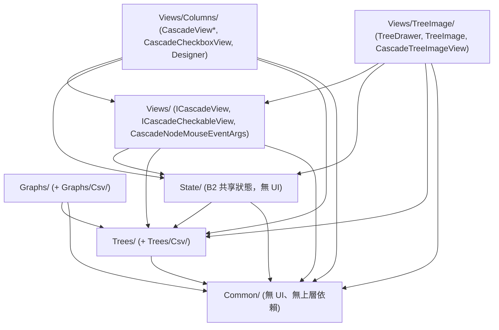

# CascadeControl 資料夾結構重構計畫

這份文件記錄 `CascadeControl` 與 `CascadeControlTests` 的領域導向資料夾重組規劃與執行結果。先前的 Plan A、Plan B2 與 Post-B2 事件統一重構已完成於 commit `9a39f85`，成為本計畫的基線。第一輪（Step 1 至 Step 5，只搬資料夾、不改 namespace）的程式碼搬遷、自動化驗證與 Visual Studio IDE 設計工具確認已全部完成。

## 目標與限制

- 分類準則依「領域與職責」劃分，不依「技術型別」建立資料夾（不建 `Interfaces/`、`EventArgs/`、`Enums/`、`Designers/`），以既有 `Trees/` 與 `Graphs/`（含各自的 `Csv/` 子資料夾）為範例。
- 依賴方向必須嚴格單向，特別是 `Views` 可依賴 `State`，`State` 不可依賴 `Views`，`Common` 不可依賴任何上層領域。
- `CascadeView.cs` 與五個 partial 檔必須留在同一個資料夾，並在 `CascadeControl/CascadeControl.csproj` 同步維護 `<Compile Include>` 與 `<DependentUpon>CascadeView.cs</DependentUpon>`。
- 所有搬遷一律使用 `git mv` 保留檔案歷史。
- 第一輪採「只搬資料夾、不改 namespace」，詳見下方的 Blast-Radius 評估。
- 每個步驟都必須獨立通過 Debug 與 Release 建置（0 錯誤、0 新增警告）、440 個單元測試全綠、組件反射與表單實例化檢查，以及在 Visual Studio 中確認 `TreeSelector` 與 `TreeViewer` 兩個 WinForms 設計工具都能正常開啟。

---

## 現況盤點（`/pstack:how` 結果）

`CascadeControl/` 目前共 40 個 `.cs` 檔（含 `Properties/AssemblyInfo.cs`），分成 `Common/`、`Trees/`、`Graphs/`、`Views/` 四個資料夾。在型別層級的依賴已經是單向無環的，但資料夾層級有三個結構問題。

### 1. `Common/` 混放三個無關職責並造成資料夾與命名空間循環

| 檔案 | 公開／內部型別 | 領域與職責 | 內部依賴（`file:line`） | UI／繪圖／設計依賴 |
|---|---|---|---|---|
| `Common/ICascadeNode.cs` | `ICascadeNode`、`CascadeNode` | 核心節點抽象與預設實作 | 無（僅 XML 註解提及 `CascadeView`） | 無 |
| `Common/MultiNameCellSyntax.cs` | `MultiNameCellSyntax` | `\|` 多名稱儲存格語法與笛卡兒展開 | 無（僅 XML 註解提及 `MenuTree`、`MenuGraph`） | 無 |
| `Common/CsvFile.cs` | `internal CsvFile` | RFC 4180 CSV 解析與格式化 | 無 | 無 |
| `Common/TreeImage.cs` | `TreeImage`、`TreeImageNode` | 樹狀圖渲染輸出與節點／展開鈕命中測試 | `CascadeControl.Trees.MenuNode`（`L1,38,53,80,91`） | `System.Drawing`（`L4`） |
| `Common/TreeDrawer.cs` | `TreeDrawScope`、`UncheckedNodeDisplay`、`TreeDrawer` | `MenuTree` 的 GDI+ 排版與繪圖引擎 | `CascadeControl.Trees`（`L1,160-165,192-198`）、`TreeImage`（`L214`） | `System.Drawing`（`L4-6`）、`System.Windows.Forms.PictureBox`（`L8,159`） |

`TreeDrawer.cs` 與 `TreeImage.cs` 在整個程式庫中只有 `Views/CascadeTreeImageView.cs`（`L62-64,351,401`）使用，卻放在 `Common/` 裡，造成 `Common ↔ Trees` 的雙向循環依賴，並把 `System.Drawing` 與 `System.Windows.Forms` 帶入原本純淨的基礎層。

### 2. `Views/` 中 B2 抽出的狀態與導覽型別已完全脫離 UI，但 `CascadeNodeEventArgs.cs` 混放了三種層級的型別

| 檔案 | 公開／內部型別 | 領域與職責 | 內部依賴（`file:line`） | UI／繪圖／設計依賴 |
|---|---|---|---|---|
| `Views/CascadeNavigator.cs` | `internal CascadeNavigator` | 選取路徑與逐節點記憶軌跡狀態機 | `Common.ICascadeNode`（`L1,23-196`） | 無 |
| `Views/CascadeState.cs` | `CascadeState`、`internal CascadeStateInvalidation` | B2 共享樹資料、選取與導覽狀態 | `Common.ICascadeNode`、`Trees.MenuTree`/`MenuNode`（`L1-2`）、`CascadeNavigator`、`CascadeNodeEventArgs`（`L38,92`） | 無 |
| `Views/CascadeCheckableState.cs` | `CascadeCheckableState` | B2 共享勾選狀態生命週期 | `Common.ICascadeNode`、`Trees.MenuTree`/`MenuCheckSet`/`MenuCheckChangedEventArgs`（`L1-2`）、`CascadeState`（`L14`） | 無 |
| `Views/ICascadeView.cs` | `ICascadeView` | 三個檢視控制項共用的導覽契約 | `Common.ICascadeNode`、`Trees.MenuTree`/`MenuNode`（`L1-2`）、`CascadeNodeEventArgs`（`L87,92`） | 無 |
| `Views/ICascadeCheckableView.cs` | `ICascadeCheckableView` | 具備勾選能力的檢視契約 | `Trees.MenuCheckSet`/`MenuCheckChangedEventArgs`（`L1`）、`ICascadeView`（`L9`） | 無 |
| `Views/CascadeNodeEventArgs.cs` | `CascadeNodeEventArgs`、`CascadeNodeMouseEventArgs`、`CascadeDrawNodeEventArgs` | **混層檔案**：無 UI 路徑事件、WinForms 滑鼠事件、GDI+ 自繪事件同放一檔 | `Common.ICascadeNode`（`L1`）、`CascadeNavigator.DEFAULT_PATH_SEPARATOR`（`L34`） | `CascadeNodeEventArgs` 無 UI 依賴；`CascadeNodeMouseEventArgs` 依賴 `System.Windows.Forms.MouseButtons`（`L99,112`）與 `System.Drawing`（`L4,100`）；`CascadeDrawNodeEventArgs` 依賴 `System.Drawing`（`L4,140`） |
| `Views/CascadeTreeEditedEventArgs.cs` | `CascadeEditAction`、`CascadeTreeEditedEventArgs` | Miller Columns 樹編輯事件契約 | `Trees.MenuNode`（`L1,48,62`） | 無 |
| `Views/CascadeColumnLayoutMode.cs` | `CascadeColumnLayoutMode` | Miller Columns 欄寬排版模式（`Fixed`/`Fill`/`Sliding`） | 無 | 無 |
| `Views/CascadeView.cs` + 5 partials（`Columns`/`Editing`/`Input`/`MultiSelect`/`Rendering`） | `CascadeView`、`internal SelectionGesture`、`internal NativeMethods` | Miller Columns 控制項本體（排版、輸入、多選、自繪、就地編輯與剪貼簿） | `Common`、`Trees`、`Trees.Csv.MenuTreeCsvText`（`Editing.cs:3,683`）、`CascadeState`、`CascadeNavigator`、`ICascadeView`、`CascadeViewDesigner`（`CascadeView.cs:31`） | `System.Windows.Forms`、`System.Drawing`、`user32.dll` P/Invoke（`Rendering.cs:203-215`） |
| `Views/CascadeCheckboxView.cs` | `CascadeCheckboxView` | 含勾選框的 Miller Columns 控制項 | `Common`、`Trees`、`CascadeView`、`CascadeCheckableState`、`ICascadeCheckableView` | `System.Windows.Forms`、`System.Windows.Forms.VisualStyles`（`L7`） |
| `Views/CascadeViewDesigner.cs` | `internal CascadeViewDesigner` | `CascadeView`／`CascadeCheckboxView` 設計階段控制項設計工具 | 無（由 `CascadeView.cs:31` 透過 `[Designer(typeof(CascadeViewDesigner))]` 引用） | `System.Windows.Forms.Design.ControlDesigner`（`System.Design`、`L4,17`） |
| `Views/CascadeTreeImageView.cs` | `TreeImageSizeMode`、`CascadeTreeImageView` | 樹狀圖檢視控制項（獨立運作或共享 `CascadeState`） | `Common`（`ICascadeNode`、`TreeDrawer`、`TreeImage`、`TreeDrawScope`、`UncheckedNodeDisplay`）、`Trees`、`CascadeState`、`CascadeCheckableState`、`ICascadeView`、`CascadeNodeEventArgs`/`MouseEventArgs` | `System.Windows.Forms`、`System.Drawing` |

檢查確認：`CascadeNavigator`、`CascadeState`、`CascadeCheckableState` 三個檔案對 `CascadeView`、`CascadeCheckboxView`、`CascadeTreeImageView`、`ICascadeView`、`System.Windows.Forms`、`System.Drawing` 全部是零依賴。唯一阻礙它們獨立移入 `State/` 的耦合點，是 `CascadeState.cs:92` 依賴 `CascadeNodeEventArgs`，而 `CascadeNodeEventArgs.cs` 同檔夾帶了 `CascadeNodeMouseEventArgs` 與 `CascadeDrawNodeEventArgs`。

### 3. `Trees/`、`Graphs/` 與 `CascadeControlTests/`

- `Trees/`（7 檔 + `Trees/Csv/` 2 檔）只依賴 `Common/`，無 UI 依賴，符合領域劃分範例。
- `Graphs/`（6 檔 + `Graphs/Csv/` 2 檔）只依賴 `Common/` 與 `Trees/`（`MenuGraph.cs:2` 的 `FromTree`/`ToTree`），無 UI 依賴，符合領域劃分範例。
- `CascadeControlTests/` 目前有兩處錯置：`Common/TreeDrawerTests.cs` 同時測試 `TreeDrawer` 與 `CascadeTreeImageView`（需 `using CascadeControl.Views` 與 WinForms）；`Views/CascadeStateTests.cs` 與 `Views/CascadeNavigatorTests.cs` 是純非 UI 狀態測試，卻與 WinForms `ViewHost` 測試混在 `Views/`。

---

## 目標資料夾樹與搬遷對照

### `CascadeControl/` 目標結構（40 檔拆成 42 檔）

```text
CascadeControl/
├── Common/                              # 共用基礎層（零上層領域與 UI 依賴）
│   ├── ICascadeNode.cs
│   ├── MultiNameCellSyntax.cs
│   └── CsvFile.cs
├── Trees/                               # 樹狀選單資料領域（維持不變）
│   ├── MenuNode.cs
│   ├── MenuTree.cs
│   ├── MenuRowStyle.cs
│   ├── MenuTreeRowWriter.cs
│   ├── MenuCheckSet.cs
│   ├── MenuCheckChangedEventArgs.cs
│   ├── MenuHistory.cs
│   └── Csv/
│       ├── MenuTreeCsvText.cs
│       └── MenuTreeCsvFile.cs
├── Graphs/                              # 有向圖資料領域（維持不變）
│   ├── MenuVertex.cs
│   ├── MenuEdge.cs
│   ├── MenuGraph.cs
│   ├── MenuGraphNode.cs
│   ├── MenuGraphRowStyle.cs
│   ├── MenuGraphRowWriter.cs
│   └── Csv/
│       ├── MenuGraphCsvText.cs
│       └── MenuGraphCsvFile.cs
├── State/                               # B2 共享導覽與勾選狀態領域（零 UI／繪圖依賴）
│   ├── CascadeNavigator.cs
│   ├── CascadeState.cs
│   ├── CascadeCheckableState.cs
│   └── CascadeNodeEventArgs.cs          # 拆分後僅保留無 UI 的 CascadeNodeEventArgs
├── Views/                               # 檢視層根目錄（多個控制項共用的契約與事件）
│   ├── ICascadeView.cs
│   ├── ICascadeCheckableView.cs
│   ├── CascadeNodeMouseEventArgs.cs     # 由 CascadeNodeEventArgs.cs 拆出，供 Columns 與 TreeImage 共用
│   ├── Columns/                         # Miller Columns 控制項領域（全部 partial 同資料夾）
│   │   ├── CascadeView.cs
│   │   ├── CascadeView.Columns.cs       # DependentUpon: CascadeView.cs
│   │   ├── CascadeView.Editing.cs       # DependentUpon: CascadeView.cs
│   │   ├── CascadeView.Input.cs         # DependentUpon: CascadeView.cs
│   │   ├── CascadeView.MultiSelect.cs   # DependentUpon: CascadeView.cs
│   │   ├── CascadeView.Rendering.cs     # DependentUpon: CascadeView.cs
│   │   ├── CascadeCheckboxView.cs
│   │   ├── CascadeColumnLayoutMode.cs
│   │   ├── CascadeDrawNodeEventArgs.cs  # 由 CascadeNodeEventArgs.cs 拆出，僅供 Columns 使用
│   │   ├── CascadeTreeEditedEventArgs.cs
│   │   └── CascadeViewDesigner.cs
│   └── TreeImage/                       # 樹狀圖渲染與檢視領域（消除 Common ↔ Trees 循環）
│       ├── TreeDrawer.cs
│       ├── TreeImage.cs
│       └── CascadeTreeImageView.cs
└── Properties/
    └── AssemblyInfo.cs
```

### 檔案搬遷對照表（`CascadeControl/`）

| 來源路徑 | 目標路徑 | 動作 | 原因 |
|---|---|---|---|
| `Common/ICascadeNode.cs` | `Common/ICascadeNode.cs` | 不動 | 全專案共用節點最小契約，零外部依賴 |
| `Common/MultiNameCellSyntax.cs` | `Common/MultiNameCellSyntax.cs` | 不動 | `Trees`、`Graphs` 與 `CascadeView.Editing` 共用的 `\|` 語法，零外部依賴 |
| `Common/CsvFile.cs` | `Common/CsvFile.cs` | 不動 | `Trees/Csv` 與 `Graphs/Csv` 共用的 RFC 4180 CSV 讀寫，零外部依賴 |
| `Common/TreeDrawer.cs` | `Views/TreeImage/TreeDrawer.cs` | `git mv` | 依賴 `Trees`、`System.Drawing` 與 `PictureBox`，且僅供 `CascadeTreeImageView` 使用；移出 `Common/` 才能消除 `Common ↔ Trees` 循環 |
| `Common/TreeImage.cs` | `Views/TreeImage/TreeImage.cs` | `git mv` | 依賴 `Trees` 與 `System.Drawing`，是 `TreeDrawer` 輸出與 `CascadeTreeImageView` 命中測試模型 |
| `Trees/**`（9 檔） | `Trees/**`（9 檔） | 不動 | 既有的領域分組範例，邊界與單向依賴皆正確 |
| `Graphs/**`（8 檔） | `Graphs/**`（8 檔） | 不動 | 既有的領域分組範例，只單向依賴 `Trees` 與 `Common` |
| `Views/CascadeNavigator.cs` | `State/CascadeNavigator.cs` | `git mv` | 純非 UI 導覽狀態機，只依賴 `Common.ICascadeNode` |
| `Views/CascadeState.cs` | `State/CascadeState.cs` | `git mv` | B2 抽出的共享資料與導覽狀態，零 WinForms 依賴 |
| `Views/CascadeCheckableState.cs` | `State/CascadeCheckableState.cs` | `git mv` | B2 抽出的共享勾選狀態，零 WinForms 依賴 |
| `Views/CascadeNodeEventArgs.cs` | `State/CascadeNodeEventArgs.cs` | 拆檔 + `git mv` | 僅保留無 UI 的 `CascadeNodeEventArgs`，讓 `State/` 不必反過來依賴 `Views/` 或 `System.Drawing` |
| （從 `Views/CascadeNodeEventArgs.cs` 拆出） | `Views/CascadeNodeMouseEventArgs.cs` | 新增檔案 | 依賴 `System.Windows.Forms.MouseButtons` 與 `System.Drawing`，同時由 `CascadeView` 與 `CascadeTreeImageView` 觸發，屬於 `Views/` 根層共用型別 |
| （從 `Views/CascadeNodeEventArgs.cs` 拆出） | `Views/Columns/CascadeDrawNodeEventArgs.cs` | 新增檔案 | 依賴 `System.Drawing`，僅用於 `CascadeView.DrawNode` 與 `CascadeCheckboxView`，屬於 Miller Columns 領域 |
| `Views/ICascadeView.cs` | `Views/ICascadeView.cs` | 不動 | 由 `Views/Columns/` 與 `Views/TreeImage/` 共同實作的檢視契約，放在 `Views/` 根層不建 `Interfaces/` 資料夾 |
| `Views/ICascadeCheckableView.cs` | `Views/ICascadeCheckableView.cs` | 不動 | 由 `CascadeCheckboxView` 實作的勾選檢視契約，與 `ICascadeView` 同放 `Views/` 根層 |
| `Views/CascadeView.cs` | `Views/Columns/CascadeView.cs` | `git mv` | Miller Columns 控制項主檔 |
| `Views/CascadeView.Columns.cs` | `Views/Columns/CascadeView.Columns.cs` | `git mv` + `DependentUpon` | 與 `CascadeView.cs` 同資料夾，補上 `<DependentUpon>CascadeView.cs</DependentUpon>` |
| `Views/CascadeView.Editing.cs` | `Views/Columns/CascadeView.Editing.cs` | `git mv` + `DependentUpon` | 與 `CascadeView.cs` 同資料夾，補上 `<DependentUpon>CascadeView.cs</DependentUpon>` |
| `Views/CascadeView.Input.cs` | `Views/Columns/CascadeView.Input.cs` | `git mv` + `DependentUpon` | 與 `CascadeView.cs` 同資料夾，補上 `<DependentUpon>CascadeView.cs</DependentUpon>` |
| `Views/CascadeView.MultiSelect.cs` | `Views/Columns/CascadeView.MultiSelect.cs` | `git mv` + `DependentUpon` | 與 `CascadeView.cs` 同資料夾，補上 `<DependentUpon>CascadeView.cs</DependentUpon>` |
| `Views/CascadeView.Rendering.cs` | `Views/Columns/CascadeView.Rendering.cs` | `git mv` + `DependentUpon` | 與 `CascadeView.cs` 同資料夾，補上 `<DependentUpon>CascadeView.cs</DependentUpon>` |
| `Views/CascadeCheckboxView.cs` | `Views/Columns/CascadeCheckboxView.cs` | `git mv` | 繼承 `CascadeView`，同屬 Miller Columns 控制項家族 |
| `Views/CascadeColumnLayoutMode.cs` | `Views/Columns/CascadeColumnLayoutMode.cs` | `git mv` | 僅供 `CascadeView` 欄位排版使用 |
| `Views/CascadeTreeEditedEventArgs.cs` | `Views/Columns/CascadeTreeEditedEventArgs.cs` | `git mv` | 僅供 `CascadeView.TreeEdited` 與 `CascadeCheckboxView` 使用 |
| `Views/CascadeViewDesigner.cs` | `Views/Columns/CascadeViewDesigner.cs` | `git mv` | 只為 `CascadeView`／`CascadeCheckboxView` 服務的設計工具，放同領域避免建立單檔技術型別資料夾 `Design/` |
| `Views/CascadeTreeImageView.cs` | `Views/TreeImage/CascadeTreeImageView.cs` | `git mv` | 樹狀圖檢視控制項，與 `TreeDrawer`、`TreeImage` 組成獨立子領域，和 `Views/Columns/` 互不相依 |
| `Properties/AssemblyInfo.cs` | `Properties/AssemblyInfo.cs` | 不動 | 組件中繼資料與 `InternalsVisibleTo("CascadeControlTests")` |

### 對應測試搬遷（`CascadeControlTests/`）

| 來源路徑 | 目標路徑 | 動作 | 原因 |
|---|---|---|---|
| `Common/CsvFileTests.cs` | `Common/CsvFileTests.cs` | 不動 | 對應 `Common/CsvFile.cs` |
| `Common/MultiNameCellSyntaxTests.cs` | `Common/MultiNameCellSyntaxTests.cs` | 不動 | 對應 `Common/MultiNameCellSyntax.cs` |
| `Common/TreeDrawerTests.cs` | `Views/TreeImage/TreeDrawerTests.cs` | `git mv` | 對應 `Views/TreeImage/`（測試 `TreeDrawer`、`TreeImage` 與 `CascadeTreeImageView`） |
| `Trees/**`（8 檔）、`Graphs/**`（9 檔） | 不動 | 不動 | 與產品專案維持 1-to-1 對應 |
| `Views/CascadeNavigatorTests.cs` | `State/CascadeNavigatorTests.cs` | `git mv` | 純非 UI 導覽測試，對應 `State/CascadeNavigator.cs` |
| `Views/CascadeStateTests.cs` | `State/CascadeStateTests.cs` | `git mv` | 純非 UI 狀態測試，對應 `State/CascadeState.cs` 與 `CascadeCheckableState.cs` |
| `Views/CascadeNodeTests.cs` | `Views/CascadeNodeTests.cs` | 不動 | 同時測試 `CascadeNode`、`CascadeNodeEventArgs` 與依賴 WinForms 的 `CascadeNodeMouseEventArgs`，留在 `Views/` 根層以保持 `Tests/State/` 零 UI 依賴 |
| `Views/CascadeCheckboxViewTests.cs` | `Views/Columns/CascadeCheckboxViewTests.cs` | `git mv` | 對應 `Views/Columns/CascadeCheckboxView.cs` |
| `Views/CascadeViewHookTests.cs` | `Views/Columns/CascadeViewHookTests.cs` | `git mv` | 對應 `Views/Columns/CascadeView*.cs` |
| `Views/CascadeViewLayoutTests.cs` | `Views/Columns/CascadeViewLayoutTests.cs` | `git mv` | 對應 `Views/Columns/CascadeView.Columns.cs` |
| `Views/CascadeViewMultiSelectTests.cs` | `Views/Columns/CascadeViewMultiSelectTests.cs` | `git mv` | 對應 `Views/Columns/CascadeView.MultiSelect.cs` |

### 單向依賴圖（嚴格無環）



- `Common/` 沒有任何往外依賴。
- `State/` 只依賴 `Common/` 與 `Trees/`，不依賴 `Views/`、`System.Drawing`、`System.Windows.Forms`。
- `Views/Columns/` 與 `Views/TreeImage/` 彼此零依賴，皆只向下依賴 `Views/` 根層、`State/`、`Trees/`、`Common/`。

---

## Namespace 變更的 Blast-Radius 評估

### 變更內容

比較兩種方案：
1. **方案 A（建議，第一輪執行）**：只重組資料夾並拆開 `CascadeNodeEventArgs.cs`，全部既有公開與內部型別維持原 `namespace`（`CascadeControl.Common`、`CascadeControl.Trees`、`CascadeControl.Graphs`、`CascadeControl.Views`）。
2. **方案 B（延後為選配第二輪）**：同步更改 `namespace`（例如 `CascadeControl.State`、`CascadeControl.Views.Columns`、`CascadeControl.Views.TreeImage`）。

### 方案 A 安全的關鍵事實與實測證明

**關鍵事實**：在 .NET Framework 4.8 MSBuild 專案中，只更改 `.cs` 檔案路徑而保留 `namespace` 宣告，編譯出的 CLR 型別全名、`[Designer(typeof(CascadeViewDesigner))]` 的組件限定設計工具字串，以及 `CascadeControl.xml` 的 XML 文件識別碼（`T:*`）完全不變。

**驗證進度**：已推進到 **Blast-Radius 第 4 階（實際執行程式驗證）**。於 `2026-11-20` 對已建置的 `CascadeControl.dll`、`CascadeControl.xml`、`CascadeControlSelector.exe`、`CascadeControlViewer.exe` 執行 PowerShell `.NET` 反射與 `TypeDescriptor` 探測，實測結果如下：

- `CascadeControl.Views.CascadeView` 的 `DesignerAttribute.DesignerTypeName` 為 `CascadeControl.Views.CascadeViewDesigner, CascadeControl, Version=1.3.0.0, Culture=neutral, PublicKeyToken=null`，解析為 `CascadeControl.Views.CascadeViewDesigner`，實例化成功。
- `CascadeControl.Views.CascadeCheckboxView` 繼承同一個 `CascadeControl.Views.CascadeViewDesigner`，實例化成功。
- `CascadeControl.Views.CascadeTreeImageView` 的設計工具解析為 `System.Windows.Forms.Design.ScrollableControlDesigner`，實例化成功。
- `CascadeControl.xml` 共 62 筆 `T:` 型別識別碼，全部只含命名空間與型別名，不含任何檔案路徑。
- `CascadeControlSelector.TreeSelector`（`Controls=2`）與 `CascadeControlViewer.TreeViewer`（`Controls=1`）實例化成功，其 `TreeSelector.resx` 與 `TreeViewer.resx` 不含任何 `CascadeControl.*` 序列化型別資料。

### 若改 Namespace（方案 B）的具體影響清單與風險

| 受影響目標 | 實際位置（`file:line`） | 若改 namespace 會如何壞掉 | 機率與成本 |
|---|---|---|---|
| `CascadeControlSelector/TreeSelector.Designer.cs` | `L33,34,70,82,83,84,117,118`（8 行全限定名稱：`CascadeControl.Views.CascadeView`、`CascadeTreeImageView`、`CascadeNodeEventArgs`、`CascadeNodeMouseEventArgs`） | WinForms 設計工具序列化寫死完整型別名；任何一個控制項或事件參數改 namespace，必須手動編輯 Designer 檔，漏改或與控制項組件不對齊時設計工具會直接顯示白屏錯誤無法開啟 | 高機率、高成本（直接破設計工具） |
| `CascadeControlViewer/TreeViewer.Designer.cs` | `L32,34,53,54,85,86,87,108,110`（9 行 `CascadeControl.Views.*`，另 `L52` 為不變的 `CascadeControl.Trees.MenuCheckChangedEventArgs`） | 同上；`CascadeCheckboxView`、`CascadeTreeImageView` 與事件參數全限定名稱都寫死在 `InitializeComponent()` 與欄位宣告 | 高機率、高成本（直接破設計工具） |
| `CascadeControlSelector/TreeSelector.cs` 與 `CascadeControlViewer/TreeViewer.cs` | `TreeSelector.cs:1-4,82`、`TreeViewer.cs:1-4,84-85` | `TreeDrawScope`、`UncheckedNodeDisplay`（原 `Common`）與 `CascadeColumnLayoutMode`、`CascadeNodeEventArgs` 等（原 `Views`）的 `using` 會編譯失敗 | 必然發生、低成本（補 `using` 即可） |
| `CascadeControlTests/` | 10 個測試檔引用 `CascadeControl.Views`（`TreeDrawerTests.cs:3` 與 `Views/*.cs`），15 個測試檔引用 `CascadeControl.Common` | 測試檔需同步補 `using`；若測試專案本身改 namespace，VSTest 測試全名也會跟著變動 | 必然發生、中成本 |
| `CascadeControl/` XML `<see cref>` 文件註解 | `CascadeControl.csproj:23-24,32-33`（`WarningLevel=4` + `DocumentationFile`）；跨檔引用見 `CascadeNodeEventArgs.cs:10`、`CascadeNavigator.cs:9`、`CascadeCheckableState.cs:12`、`MenuCheckSet.cs:16,51` | 跨命名空間的 `<see cref>` 會觸發 CS1574 編譯警告，導致 IntelliSense XML 連結失效 | 高機率、中成本 |
| `README.md` | `L21,67-69,275,481,520,528,577,589,597,618,627,646,655,662,687`（15 處明載命名空間與範例 `using`） | 文件與實際命名空間脫節；外部使用者依 `README.md:31-43` 從工具箱加入 `CascadeControl.dll` 時，控制項型別全名變更會造成既有表單與工具箱失效 | 必然發生、中成本 |

### 已確認無風險項目（Cleared）

- `TreeSelector.resx` 與 `TreeViewer.resx`：兩檔皆只有標準 `ResX` schema 與表頭（各 120 行），沒有序列化任何 `CascadeControl` 型別。
- `CascadeView.cs:31`：`[Designer(typeof(CascadeViewDesigner))]` 是編譯期 `typeof(...)` 而非硬編碼字串，搬移檔案位置不會讓設計工具連結失效。
- `CascadeControl/Properties/AssemblyInfo.cs:6`：`[assembly: InternalsVisibleTo("CascadeControlTests")]` 綁定的是組件名稱，不受資料夾與命名空間搬移影響。
- `CascadeView.Editing.cs:26`：`CLIPBOARD_FORMAT = "CascadeControl.MenuNodes"` 是固定剪貼簿格式字串，不隨檔案路徑改變。

### 決策建議

- **第一輪（本計畫執行範圍）**：只搬移資料夾並拆分 `CascadeNodeEventArgs.cs`，**不改任何 `namespace`**。這樣能把「整理資料夾結構」與「破壞性命名空間更名」完全隔開，第一輪零 Designer 風險、零 `README.md` 破壞、`TreeSelector` 與 `TreeViewer` 一行都不用改。
- **第二輪（選配，等第一輪穩定後再另案評估）**：若未來想讓編譯器在 `using` 層級強制封鎖循環，只需考慮兩個低摩擦子選項：
  1. 僅把 `TreeDrawer`、`TreeImage`、`TreeDrawScope`、`UncheckedNodeDisplay` 從 `CascadeControl.Common` 改入 `CascadeControl.Views`（不影響任何 `Designer.cs`，只動 `TreeSelector.cs`、`TreeViewer.cs`、`TreeDrawerTests.cs`、`README.md`），就能在命名空間層級徹底消除 `Common ↔ Trees` 循環。
  2. `CascadeView`、`CascadeCheckboxView`、`CascadeTreeImageView` 即使在第二輪也建議保留在 `CascadeControl.Views`，避免破壞兩個 `Designer.cs` 與 WinForms 工具箱。

---

## 執行步驟與驗證清單（第一輪：只搬資料夾、不改 Namespace）

### 依賴順序圖

`Step 1` → `Step 2` → `Step 3` → `Step 4` → `Step 5`（全程循序在同一個分支上建立 5 個可獨立驗證與回退的小 commit，每步皆通過建置、測試與設計工具檢查後才進下一步）。

### 共用驗證指令

每一個步驟完成後，在倉庫根目錄 `D:\github\CascadeControl` 依序執行以下三個自動化檢查，再於 Visual Studio 開啟兩個表單設計工具確認：

```powershell
# 1. Debug 與 Release 建置（0 錯誤、0 新增警告）
& "C:\Program Files\Microsoft Visual Studio\18\Community\MSBuild\Current\Bin\MSBuild.exe" CascadeControl.sln /p:Configuration=Debug /nologo /v:minimal
& "C:\Program Files\Microsoft Visual Studio\18\Community\MSBuild\Current\Bin\MSBuild.exe" CascadeControl.sln /p:Configuration=Release /nologo /v:minimal

# 2. 單元測試（預期 440 / 440 全部通過）
& "C:\Program Files\Microsoft Visual Studio\18\Community\Common7\IDE\CommonExtensions\Microsoft\TestWindow\vstest.console.exe" CascadeControlTests\bin\Debug\CascadeControlTests.dll

# 3. 設計工具屬性與表單實例化驗證（驗證 CascadeViewDesigner 綁定與 InitializeComponent）
powershell -NoProfile -Command '
Add-Type -AssemblyName System.Windows.Forms
Add-Type -AssemblyName System.Design
$asm = [System.Reflection.Assembly]::LoadFrom("D:\github\CascadeControl\CascadeControl\bin\Debug\CascadeControl.dll")
foreach ($n in @("CascadeControl.Views.CascadeView","CascadeControl.Views.CascadeCheckboxView","CascadeControl.Views.CascadeTreeImageView")) {
	$t = $asm.GetType($n)
	$da = [System.ComponentModel.TypeDescriptor]::GetAttributes($t)[[System.ComponentModel.DesignerAttribute]]
	$dt = [Type]::GetType($da.DesignerTypeName)
	if (-not $dt) { throw "Designer resolution failed for $n" }
	$inst = [Activator]::CreateInstance($t); $inst.Dispose()
	Write-Output "$n -> $($dt.FullName) OK"
}
[System.Reflection.Assembly]::LoadFrom("D:\github\CascadeControl\CascadeControlSelector\bin\Debug\CascadeControlSelector.exe") | Out-Null
[System.Reflection.Assembly]::LoadFrom("D:\github\CascadeControl\CascadeControlViewer\bin\Debug\CascadeControlViewer.exe") | Out-Null
$s = New-Object CascadeControlSelector.TreeSelector; if ($s.Controls.Count -lt 2) { throw "TreeSelector missing controls" }; $s.Dispose()
$v = New-Object CascadeControlViewer.TreeViewer; if ($v.Controls.Count -lt 1) { throw "TreeViewer missing controls" }; $v.Dispose()
Write-Output "Forms OK"
'
```

---

### Step 1：拆分 `CascadeNodeEventArgs.cs` 為三個單一職責檔案（commit `7369f91`）

把程式碼拆檔與後續 `git mv` 分開成獨立 commit，確保後續步驟 `git log --follow` 維持 100% 檔案更名偵測率。

- [x] **前置依賴**：工作目錄乾淨（基線 commit `9a39f85`）。
- [x] **異動檔案**：
  - 修改 `CascadeControl/Views/CascadeNodeEventArgs.cs`（僅保留 `CascadeNodeEventArgs` 並移除未使用的 `using System.Drawing;`）。
  - 新增 `CascadeControl/Views/CascadeNodeMouseEventArgs.cs`（放入 `CascadeNodeMouseEventArgs`，維持 `namespace CascadeControl.Views` 與原 XML 註解）。
  - 新增 `CascadeControl/Views/CascadeDrawNodeEventArgs.cs`（放入 `CascadeDrawNodeEventArgs`，維持 `namespace CascadeControl.Views` 與原 XML 註解）。
  - 修改 `CascadeControl/CascadeControl.csproj`（新增兩筆 `<Compile Include>`）。
- [x] **單一變更內容**：將混放三層依賴的 `CascadeNodeEventArgs.cs` 拆開，使 `CascadeNodeEventArgs.cs` 成為 100% 無 UI 依賴的檔案。
- [x] **預期可見結果**：`CascadeNodeEventArgs.cs` 不再出現 `System.Drawing` 或 `System.Windows.Forms`；`CascadeControl.xml` 的 62 個 `T:` 識別碼不變。
- [x] **驗證（Unit / Live / Designer）**：
  - [x] Debug 與 Release MSBuild 通過（0 錯誤、0 新增警告）。
  - [x] `vstest.console.exe` 通過 440 / 440（14.41 秒）。
  - [x] PowerShell 反射探測輸出三個控制項設計工具 `OK` 與 `Forms OK`。
  - [x] Visual Studio 設計工具正常開啟 `CascadeControlSelector/TreeSelector.cs` 與 `CascadeControlViewer/TreeViewer.cs`（操作者於 2026-11-20 確認通過）。

---

### Step 2：建立 `State/` 領域（搬移 B2 無 UI 狀態與導覽檔案，commit `cae95bb`）

- [x] **前置依賴**：Step 1 通過並 commit（`7369f91`）。
- [x] **異動檔案**：
  - `git mv CascadeControl/Views/CascadeNavigator.cs CascadeControl/State/CascadeNavigator.cs`
  - `git mv CascadeControl/Views/CascadeState.cs CascadeControl/State/CascadeState.cs`
  - `git mv CascadeControl/Views/CascadeCheckableState.cs CascadeControl/State/CascadeCheckableState.cs`
  - `git mv CascadeControl/Views/CascadeNodeEventArgs.cs CascadeControl/State/CascadeNodeEventArgs.cs`
  - `git mv CascadeControlTests/Views/CascadeNavigatorTests.cs CascadeControlTests/State/CascadeNavigatorTests.cs`
  - `git mv CascadeControlTests/Views/CascadeStateTests.cs CascadeControlTests/State/CascadeStateTests.cs`
  - 修改 `CascadeControl/CascadeControl.csproj` 與 `CascadeControlTests/CascadeControlTests.csproj` 的 `<Compile Include>`。
- [x] **單一變更內容**：把 B2 抽出的共享狀態與導覽狀態機集中到 `State/`，測試同步對應。
- [x] **預期可見結果**：`CascadeControl/State/` 共 4 檔，非註解程式碼對 `System.Windows.Forms`、`System.Drawing` 與控制項引用為 0 筆。
- [x] **驗證（Unit / Live / Designer）**：
  - [x] 靜態依賴檢查確認 `CascadeControl/State/` 無 `System.Windows.Forms`、`System.Drawing` 或控制項型別程式碼引用。
  - [x] Debug 與 Release MSBuild 通過（0 錯誤、0 新增警告）。
  - [x] `vstest.console.exe` 通過 440 / 440（14.38 秒）。
  - [x] PowerShell 反射探測輸出 `OK` 與 `Forms OK`。
  - [x] Visual Studio 設計工具正常開啟 `TreeSelector.cs` 與 `TreeViewer.cs`（操作者於 2026-11-20 確認通過）。

---

### Step 3：建立 `Views/TreeImage/` 領域（消除 `Common ↔ Trees` 循環，commit `4fa70b5`）

- [x] **前置依賴**：Step 2 通過並 commit（`cae95bb`）。
- [x] **異動檔案**：
  - `git mv CascadeControl/Common/TreeDrawer.cs CascadeControl/Views/TreeImage/TreeDrawer.cs`
  - `git mv CascadeControl/Common/TreeImage.cs CascadeControl/Views/TreeImage/TreeImage.cs`
  - `git mv CascadeControl/Views/CascadeTreeImageView.cs CascadeControl/Views/TreeImage/CascadeTreeImageView.cs`
  - `git mv CascadeControlTests/Common/TreeDrawerTests.cs CascadeControlTests/Views/TreeImage/TreeDrawerTests.cs`
  - 修改 `CascadeControl/CascadeControl.csproj` 與 `CascadeControlTests/CascadeControlTests.csproj` 的 `<Compile Include>`。
- [x] **單一變更內容**：把樹狀圖繪製引擎與 `CascadeTreeImageView` 集中至 `Views/TreeImage/`，讓 `Common/` 恢復純基礎層。
- [x] **預期可見結果**：`CascadeControl/Common/` 只剩 3 個檔案（`ICascadeNode.cs`、`MultiNameCellSyntax.cs`、`CsvFile.cs`），對 `Trees`、`System.Drawing`、`System.Windows.Forms` 程式碼引用為 0 筆。
- [x] **驗證（Unit / Live / Designer）**：
  - [x] 靜態依賴檢查確認 `CascadeControl/Common/` 無 `CascadeControl.Trees`、`System.Drawing`、`System.Windows.Forms` 程式碼引用。
  - [x] Debug 與 Release MSBuild 通過（0 錯誤、0 新增警告）。
  - [x] `vstest.console.exe` 通過 440 / 440（13.80 秒）。
  - [x] PowerShell 反射探測輸出 `OK` 與 `Forms OK`。
  - [x] Visual Studio 設計工具正常開啟 `TreeSelector.cs` 與 `TreeViewer.cs`，確認右側 `treeImageView1` 正常顯示（操作者於 2026-11-20 確認通過）。

---

### Step 4：建立 `Views/Columns/` 領域並為 `CascadeView` partial 檔補上 `DependentUpon`（commit `8e82e72`）

- [x] **前置依賴**：Step 3 通過並 commit（`4fa70b5`）。
- [x] **異動檔案**：
  - `git mv` 以下 11 個檔案從 `CascadeControl/Views/` 至 `CascadeControl/Views/Columns/`：
    - `CascadeView.cs`、`CascadeView.Columns.cs`、`CascadeView.Editing.cs`、`CascadeView.Input.cs`、`CascadeView.MultiSelect.cs`、`CascadeView.Rendering.cs`
    - `CascadeCheckboxView.cs`、`CascadeColumnLayoutMode.cs`、`CascadeDrawNodeEventArgs.cs`、`CascadeTreeEditedEventArgs.cs`、`CascadeViewDesigner.cs`
  - `git mv` 以下 4 個測試檔從 `CascadeControlTests/Views/` 至 `CascadeControlTests/Views/Columns/`：
    - `CascadeCheckboxViewTests.cs`、`CascadeViewHookTests.cs`、`CascadeViewLayoutTests.cs`、`CascadeViewMultiSelectTests.cs`
  - 修改 `CascadeControl/CascadeControl.csproj`：更新 11 筆 `<Compile Include>`，並為五個 partial 檔補上 `<DependentUpon>CascadeView.cs</DependentUpon>`：
    ```xml
    <Compile Include="Views\Columns\CascadeView.cs" />
    <Compile Include="Views\Columns\CascadeView.Columns.cs">
    	<DependentUpon>CascadeView.cs</DependentUpon>
    </Compile>
    <Compile Include="Views\Columns\CascadeView.Editing.cs">
    	<DependentUpon>CascadeView.cs</DependentUpon>
    </Compile>
    <Compile Include="Views\Columns\CascadeView.Input.cs">
    	<DependentUpon>CascadeView.cs</DependentUpon>
    </Compile>
    <Compile Include="Views\Columns\CascadeView.MultiSelect.cs">
    	<DependentUpon>CascadeView.cs</DependentUpon>
    </Compile>
    <Compile Include="Views\Columns\CascadeView.Rendering.cs">
    	<DependentUpon>CascadeView.cs</DependentUpon>
    </Compile>
    ```
  - 修改 `CascadeControlTests/CascadeControlTests.csproj`：更新 4 筆 `<Compile Include>`。
- [x] **單一變更內容**：將 Miller Columns 控制項家族（含所有 partial 檔與 `CascadeViewDesigner`）獨立到 `Views/Columns/`，並在方案總管以 `DependentUpon` 折疊 partial 檔。
- [x] **預期可見結果**：`Views/` 根目錄只剩 3 個跨控制項共用檔（`ICascadeView.cs`、`ICascadeCheckableView.cs`、`CascadeNodeMouseEventArgs.cs`）；`Views/Columns/` 與 `Views/TreeImage/` 彼此無程式碼引用。
- [x] **驗證（Unit / Live / Designer）**：
  - [x] 靜態依賴檢查確認 `Views/Columns/` 無引用 `TreeDrawer`/`TreeImage`/`CascadeTreeImageView`，`Views/TreeImage/` 無引用 `CascadeView`/`CascadeCheckboxView`。
  - [x] Debug 與 Release MSBuild 通過（0 錯誤、0 新增警告）。
  - [x] `vstest.console.exe` 通過 440 / 440（13.27 秒）。
  - [x] PowerShell 反射探測輸出 `OK`、`Forms OK` 與 `DependentUpon count: 5`。
  - [x] Visual Studio 方案總管確認五個 `CascadeView.*.cs` 折疊在 `CascadeView.cs` 下方，且設計工具正常開啟 `TreeSelector.cs` 與 `TreeViewer.cs`（操作者於 2026-11-20 確認通過）。

---

### Step 5：最終等價性稽核與紀錄更新

- [x] **前置依賴**：Step 4 通過並 commit（`8e82e72`）。
- [x] **異動檔案**：更新 `docs/refactor-plan.md` 勾選狀態與驗證紀錄。
- [x] **單一變更內容**：對照基線檢查組件型別、XML 文件 ID、git 歷史追蹤與目錄單向依賴規則。
- [x] **預期可見結果**：
  - `CascadeControl.xml` 的 62 筆 `T:` ID 與基線 62/62 完全一致（`Compare-Object` 零差異）。
  - `git log --follow` 驗證 `TreeDrawer.cs`、`CascadeState.cs`、`CascadeView.cs` 皆可追溯至重組前歷史。
  - `git diff 9a39f85..HEAD -- CascadeControlSelector CascadeControlViewer README.md` 為 0 行變更。
- [x] **驗證（Unit / Live / Designer）**：
  - [x] Debug 與 Release MSBuild 通過（0 錯誤、0 新增警告；既有 `TreeDrawer.cs(622)` 兩筆 CS1573 警告與基線相同）。
  - [x] `vstest.console.exe` 通過 440 / 440（13.27 秒）。
  - [x] PowerShell 反射探測與 XML ID 比對（62/62）全數通過。
  - [x] 實地於 Visual Studio 設計工具複驗 `TreeSelector.cs` 與 `TreeViewer.cs`，並展開 `Views/Columns/CascadeView.cs` 確認 `DependentUpon` 折疊（操作者於 2026-11-20 確認通過）。

---

## 執行紀錄（2026-11-20）

- `7369f91`（Step 1）：拆分 `CascadeNodeEventArgs.cs` 為三檔並更新 `CascadeControl.csproj`。Debug 與 Release MSBuild 0 錯誤 0 新增警告，`vstest` 440 / 440（14.41 秒），XML 62 筆，設計工具屬性與表單實例化全過。
- `cae95bb`（Step 2）：以 `git mv` 搬遷 4 個狀態檔與 2 個測試檔至 `State/`（全數 100% rename）。Debug 與 Release MSBuild 0 錯誤 0 新增警告，`vstest` 440 / 440（14.38 秒），`State/` 零 UI 程式碼引用。
- `4fa70b5`（Step 3）：以 `git mv` 搬遷 `TreeDrawer.cs`、`TreeImage.cs`、`CascadeTreeImageView.cs` 與 `TreeDrawerTests.cs` 至 `Views/TreeImage/`（全數 100% rename）。Debug 與 Release MSBuild 0 錯誤 0 新增警告，`vstest` 440 / 440（13.80 秒），`Common/` 收斂為 3 個零依賴檔。
- `8e82e72`（Step 4）：以 `git mv` 搬遷 11 個控制項檔與 4 個測試檔至 `Views/Columns/`（全數 100% rename），並為五個 `CascadeView.*.cs` 補上 `<DependentUpon>CascadeView.cs</DependentUpon>`。Debug 與 Release MSBuild 0 錯誤 0 新增警告，`vstest` 440 / 440（13.27 秒），XML 62 / 62 與基線完全一致，兩個 WinForms 專案與 `README.md` 皆為 0 變更。
- `d85a2f1` + `8c85ca5`（第一輪 Step 5）：Visual Studio IDE 設計工具（`TreeSelector.cs` 與 `TreeViewer.cs`）與方案總管 `DependentUpon` 折疊經操作者實測確認通過，第一輪資料夾重組全數結案。

---

## 第二輪：對齊 C# IDE0130 Namespace 規範（執行紀錄）

依操作者決議，在確認無外部下游呼叫端的前提下，將全部 namespace 對齊資料夾路徑以符合 C# IDE0130 規範（`State/` → `CascadeControl.State`、`Views/Columns/` → `CascadeControl.Views.Columns`、`Views/TreeImage/` → `CascadeControl.Views.TreeImage`，並同步 `CascadeControlTests`）。

- [x] **Round 2, Step 1（commit `ad1edae`）**：`Views/TreeImage/` 對齊 `CascadeControl.Views.TreeImage`（`TreeDrawer`、`TreeImage`、`CascadeTreeImageView`、`TreeDrawerTests`、兩個表單與 `Designer.cs`）。Debug 與 Release MSBuild 0 錯誤 0 新增警告，`vstest` 440 / 440（12.01 秒），設計工具屬性與表單實例化通過。
- [x] **Round 2, Step 2（commit `89af526`）**：`State/` 對齊 `CascadeControl.State`（`CascadeNavigator`、`CascadeState`、`CascadeCheckableState`、`CascadeNodeEventArgs`、`CascadeNavigatorTests`、`CascadeStateTests`、兩個表單與 `Designer.cs`）。Debug 與 Release MSBuild 0 錯誤 0 新增警告，`vstest` 440 / 440（13.24 秒），設計工具屬性與表單實例化通過。
- [x] **Round 2, Step 3（commit `481ff70`）**：`Views/Columns/` 對齊 `CascadeControl.Views.Columns`（`CascadeView*`、`CascadeCheckboxView`、`CascadeColumnLayoutMode`、`CascadeDrawNodeEventArgs`、`CascadeTreeEditedEventArgs`、`CascadeViewDesigner`、4 個 Columns 測試檔、全組件 `<see cref>` 註解、兩個表單與 `Designer.cs`）。Debug 與 Release MSBuild 0 錯誤 0 新增警告，`vstest` 440 / 440（12.83 秒），PowerShell 腳本實測 `CascadeControl` 與 `CascadeControlTests` 全部 `.cs` 檔 100% 符合 IDE0130（0 筆不一致），`CascadeViewDesigner` 解析與 `TreeSelector`／`TreeViewer` 實例化全部通過，`CascadeControl.xml` 維持 62 筆 `T:` 型別識別碼。
- [x] **Round 2, Step 4**：更新 `README.md` 命名空間與範例 `using` 說明並補寫本紀錄。
- [ ] **Visual Studio IDE 最終確認**：在 Visual Studio 執行 Rebuild Solution 後，開啟 `CascadeControlSelector/TreeSelector.cs` 與 `CascadeControlViewer/TreeViewer.cs` 設計工具確認新命名空間下的控制項與 `CascadeViewDesigner` 皆正常顯示。
